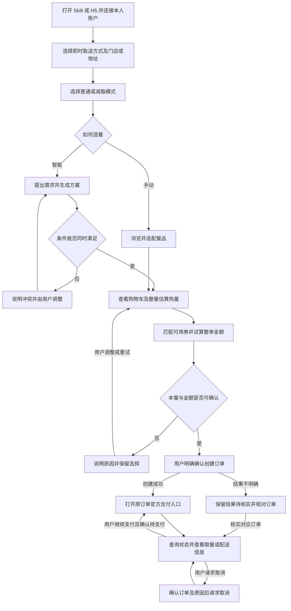
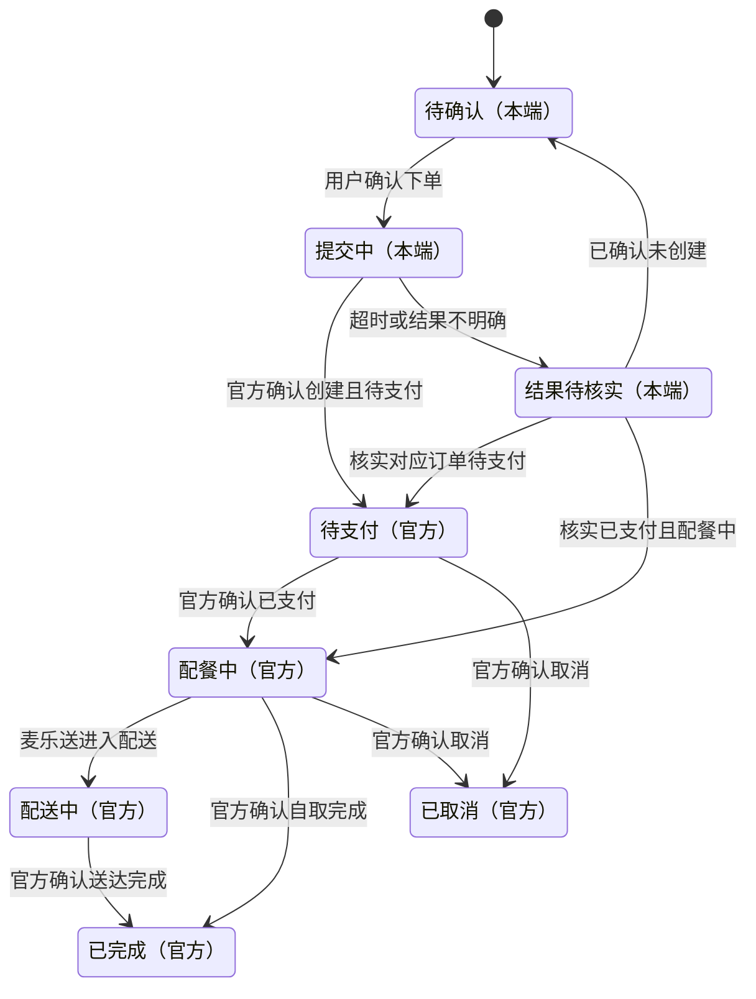
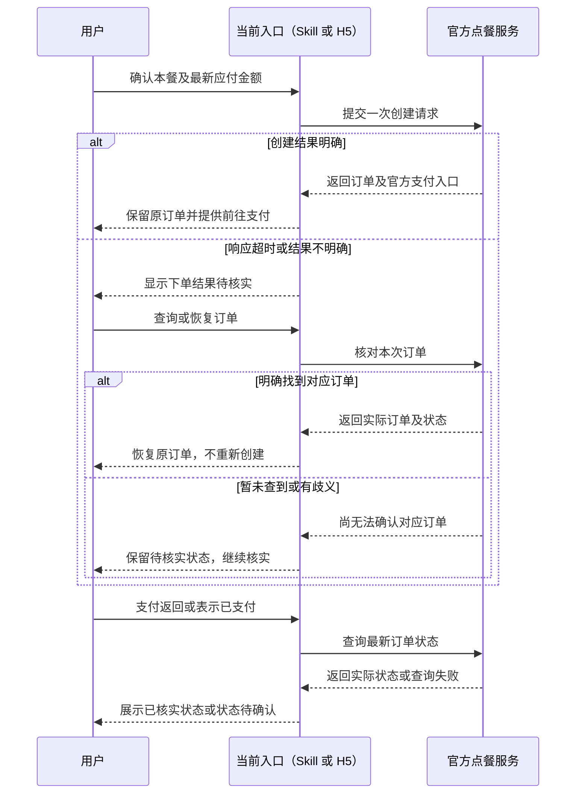

# 产品需求文档：麦当劳点餐助手（Skill + H5） - V1.19

| 项目 | 内容 |
|---|---|
| PRD 标识 | PRD-001 |
| 版本 | V1.19 |
| 日期 | 2026-10-24（北京时间） |
| 状态 | 业务需求定稿；V1.1 补口径、V1.2/V1.4 校准分类与取餐方式、V1.3 修正去酱路径、V1.5 落营养数据、V1.6 补移动端规范、V1.7 增定位获取地址、V1.11 落地智能配餐、V1.12/V1.13 修正配餐数字口径、V1.14 修正方案取样与多样性、V1.15 增加三大营养素显示与筛选、V1.16 修减脂菜单咖啡不显示、V1.17 智能解析（MiniMax）、V1.18 人均热量与份数弹性、V1.19 宽松条件多给方案（见 §1.4、§1.5）；功能实现与真实联调按验收标准另行验证 |
| 目标用户 | 本人自用／演示 |
| 交付物 | 独立点餐 Skill 包、独立手机 H5 工程／自用演示入口、内置营养基准表、分类归一表与商品清单 |

## 1. 综述 (Overview)

### 1.1 项目背景与核心问题

用户希望通过熟悉的菜单操作或一句自然语言完成麦当劳配餐，了解这一餐的大概热量，并自动使用当前订单可用的优惠券。典型需求包括“总热量在 1000 千卡以下，尽量吃饱”和“想吃炸鸡，其余帮我搭配”。

首版围绕本人真实账户完成即时点餐，分别交付 Skill 与手机 H5。两项交付均覆盖选门店、普通／减脂模式、手动／智能选餐、热量估算、用券试算、确认下单、官方支付引导、订单查询及取消。

**需求基线**

| 维度 | 已确认要求 |
|---|---|
| 独立入口 | Skill 可在 WorkBuddy 与 Codex 独立使用；手机 H5 可独立使用。允许共用服务及业务规则 |
| 取餐范围 | 立即到店自取、麦乐送尽快配送 |
| 普通模式 | 可选择当前门店全部可售餐品及合法定制，包含可售咖啡，展示单品及整餐估算热量 |
| 减脂模式 | 允许汉堡及以黑咖啡为基础的咖啡；汉堡强制去酱且不能取消，咖啡默认不加奶油球但可选择添加 |
| 减脂模式咖啡范围 | 以黑咖啡为基础，奶油球为可选例外；其他添加项暂不开放，含奶拿铁不按黑咖啡处理 |
| 热量 | 优先采用适用营养数据，缺少时合理估算；去酱估算扣减，奶油球计入；单品和整餐显示“约 X 千卡”，X 为整数 |
| 热量数据来源 | 工程内自带本地营养基准表（商品编码→热量，逐条标注 official／estimate），去酱扣减与奶油球参数同表维护、统一版本化；无法关联官方数据不等于不显示热量（见 §1.4.4） |
| 减脂范围判定 | 门店菜单把汉堡分为多个子类（实测：鸡肉汉堡/卷、巨无霸/牛鱼肉堡、安格斯MAX/厚牛堡），咖啡类目名为“麦咖啡™”；以分类归一为主判定，叠加套餐组成校验与商品清单兜底，商品名不参与判定（见 §1.4.5） |
| 智能配餐 | 识别热量、预算、必选／排除项和偏好，最多展示三个有效方案，支持锁定餐品后局部替换 |
| 优惠券 | 默认使用已校验、已试算方案中应付最低的可用券组合；允许换券，不提供主动不用券入口，仅确认无可用券时不用券 |
| 价格 | 商品卡展示门店当前商品价；整单实付采用官方试算，包含适用的配送、打包及餐具等费用 |
| 餐具 | 确认页提供“需要餐具”开关，**默认需要**，按官方返回的餐具费计入应付并参与试算 |
| 页面风格 | 参考麦当劳分类点餐结构，浅色背景、黄色主按钮、红色强调信息，适配手机操作 |
| 订单确认 | 明确确认最新餐品、定制与金额后创建订单；付款由用户在官方渠道完成 |
| 首版不纳入 | 随单购 withOrder、自动领券、积分／商城／抽奖、团餐、得来速、预约（见 §1.4.8） |

**范围边界**

- 本期只做 Skill 与手机 H5；微信小程序设计、迁移适配和上线暂不做。
- 本期使用本人账户，不扩展多用户账户体系；只支持即时自取和配送，不含预约、得来速与企业团餐。
- 首版不展示、不使用随单购优惠（接口支持 `withOrder`，但会改变“最低应付”的比较口径），如需开放须先修订 §1.4.6 与本节范围。
- 自动用券范围是使用已有适用券，不扩展自动领券、付费购券和积分兑换。
- 具体技术框架、是否分仓及实现算法由实现阶段决定，不能改变本 PRD 的业务和验收口径。
- 现有图标素材：[app-icon.png](../../assets/app-icon.png)。

**实现联调项**

以下是功能验收前需要完成的验证工作，不代表这些能力已经通过实测：

| 联调项 | 验证要求 |
|---|---|
| 去酱提交 | 已验证至试算层：单品汉堡 `modification` 含酱料项（麦香鸡酱 100136／烤味酱），按 `unselectedKey` 传入可被 `calculate-price` 接受且金额不变；待验证创建订单是否原样携带并回显。未返回特制项的餐品仍需逐项核查，渠道待确认不等于不支持 |
| 菜单分类 | 已实测上海 1450713 与郑州 3560134 两家门店：分类名集合一致（郑州少“蘸酱炸鸡”），8 个分类名含换行符，咖啡类目名为“麦咖啡™”，归一表可跨城复用；仍需继续抽查更多城市并回填 `data/menu-taxonomy.yaml`；抓取用 `scripts/fetch-mcd-categories.py`（只读查询，输出快照到 `data/`） |
| 到店备注 | 去酱已改由特制项提交，备注不再是去酱的必要途径；到店是否接受并传递备注仍待验证，不直接断言不支持；麦乐送订单备注在已读取定义中有明确支持 |
| 奶油球 | 校验门店是否返回对应选项、数量及价格，不能虚构已配置 |
| 营养基准表 | 官方清单 160 条、无商品编码、通用品类口径；同名精确命中 22/141，套餐 50 项须按组成合计，12 项归一候选待人工核对，57 项需补录或估算；素材见 `data/nutrition-official.csv` 与 `data/nutrition-mapping.csv` |
| 定位反查 | 反查链为 Photon（街道/小区）→ BigDataCloud（区县），均已实测可用；需抽查更多城市命中率，并注意接口返回距离以关键词位置为基准、非手机坐标；非 HTTPS 环境下浏览器不给定位 |
| 餐具费 | 校验试算与订单是否返回餐具费金额，默认“需要餐具”时的费用是否按官方返回计入 |
| 官方支付 | 在 WorkBuddy、Codex 及实际演示手机浏览器分别验证原始支付入口与返回后查单流程 |
| 真实订单与取消 | 验证创建、恢复、查询和取消的实际结果，不以模拟结果替代真实联调 |

需求依据为[已确认的梳理记录](../需求梳理记录.md)。接入参考包括[项目调研](../../调研报告.md)、[工具定义快照](../../mcp-tools.schema.txt)及[麦当劳官方接入说明](https://github.com/M-China/mcd-mcp-server)。本 PRD 不包含真实凭据。

### 1.2 核心业务流程 / 用户旅程地图

| 阶段 | 用户目标 | 对应用户故事 |
|---|---|---|
| 一、接入与选店 | 通过可用入口连接本人账户，确定即时取送方式与门店／地址 | US-08、US-05 |
| 二、模式与购物车 | 选择普通或减脂模式，明确已有商品、定制与切换影响 | US-01 |
| 三、选餐与配餐 | 按菜单手动选餐，或用自然语言生成、锁定及替换方案 | US-07、US-03 |
| 四、分析与结算 | 查看本餐估算热量，自动匹配优惠并确认实际应付 | US-02、US-04 |
| 五、交易与取餐 | 明确下单，前往官方支付，恢复及查询订单，按需取消 | US-06 |

用户可在确认下单前返回选餐或调整条件。每次相关选择变化后，热量、优惠和价格重新核对。

> 编号说明：用户故事编号（US-01～US-08）沿用立项时的确认顺序，正文按阶段顺序排列，因此编号与阅读顺序不一致属正常。检索按编号，阅读按阶段。

### 1.3 Mermaid 图（流程/状态/时序）

#### 1.3.1 用户操作流



查询失败与确实无结果分别展示。生成推荐及查看价格不会创建订单；创建未决时不自动重试，核实路径见下方状态及交互图。

#### 1.3.2 下单处理与订单生命周期

“待确认、提交中、结果待核实”属于本端处理状态；其余状态采用官方订单结果，不由本端推测。



近期订单暂未查到不等于已确认未创建。查询时若已经完成或取消，直接展示官方最新状态；用户无需逐个经历图中状态。支付截止时间已到也不直接等于已取消。官方状态码与本图状态的对应关系（含“餐厅确认配餐中”“已评价”）见 §1.4.2。

#### 1.3.3 下单超时核实与支付返回交互



### 1.4 全局口径与实现约束

以下口径为全部用户故事共同遵守的底层约定。故事正文只引用本节，不重复定义；两者冲突时以本节为准。

#### 1.4.1 金额与数值口径

- 官方**价格试算的主金额字段**（商品费、优惠总额、配送费及应付等）为「分」的整数；`enjoyable`／`enjoyed` 中的优惠提示有按类型解释的例外。**创建订单／查询订单**中的金额逐字段核对，未标注单位的字段须实测确认，不能统一假设为元。
- 已明确为分的字段按整数计算，展示时转为元；已明确为元的字段按元处理；折扣值不当作货币金额。**禁止出现“统一除以 100”的全局转换**，只在明确的字段边界换算。
- 新增或未标注单位的金额字段，实现前必须按接口描述逐字段核对，不得推断。首版涉及的字段口径：

| 来源 | 字段 | 单位 | 用途 |
|---|---|---|---|
| 试算 | productPrice／discount／deliveryPrice／packingPrice／tablewarePrice／price | 分（已明确） | 商品费、优惠、配送、打包、餐具、应付 |
| 试算 | enjoyable.balance／enjoyed.balance | 分（已明确） | 优惠门槛差额 |
| 试算 | enjoyable.realDiscount／enjoyed.realDiscount | 按 amountType：1 特价、3 立减时为元；2 时为折扣值 | 优惠提示，不统一除以 100，不替代整单应付 |
| 订单 | price／tablewarePrice／realPackingFeeTotalPrice | 元（已明确） | 订单详情展示 |
| 订单 | realTotalAmount／productPrice／deliveryPrice／realDeliveryPrice | 接口未标注单位，**必须实测确认后处理** | 与试算金额比对、金额变化提示 |
| 订单 | couponList[].discountAmount | 接口未标注单位，需实测确认 | 优惠明细展示 |

- 上表标注“需实测确认”的字段，在联调阶段逐一核对真实返回值后回填本表；核对前不得把它当作已确认口径写进实现假设。
- 金额统一展示为 `¥` + 两位小数。热量取整口径见 US-02，不在本节重复。

#### 1.4.2 官方订单状态映射

| 官方 orderStatus | 官方含义 | 本端展示 | 可用操作 |
|---|---|---|---|
| 1 | 待支付 | 待支付 | 前往官方支付、取消、刷新 |
| 2 | 配餐中（已支付） | 配餐中 | 刷新、取消（按官方结果） |
| 10 | 配餐中-餐厅确认配餐中 | 配餐中 | 刷新、取消（按官方结果） |
| 4 | 配送中 | 配送中 | 刷新 |
| 6 | 已完成 | 已完成 | 刷新 |
| 7 | 已取消 | 已取消 | 刷新 |
| 8 | 已评价 | 已完成（附注“已评价”） | 刷新 |
| 其他或缺失 | 未知 | 状态暂未确认 | 刷新、重查 |

- 官方返回码是本端订单状态的唯一来源，不用本地时间、页面回流或用户自述推断。
- 状态文案与按钮可见性由本表驱动，Skill 与 H5 共用同一张表，不各自维护。

#### 1.4.3 取餐场景参数（固定，不得由模型推测）

| 场景 | beType | orderType | beCode | 其他必传 | 实测取值 |
|---|---|---|---|---|---|
| 到店自取 | 1 | 1 | 不传（传了会报错） | takeWayCode 必须从**本次试算**返回的 takeWayList 中取，禁止写死 | 上海 1450713：`eat-in`(堂食)、`locker-out`(外带)；郑州 3560134：`eat-in`(堂食)、`take-in-store`(外带) |
| 麦乐送 | 2 | 2 | 必传，来自 delivery-query-stores | addressId 来自配送地址 | 待实测 |

- **新增必填项**：到店自取必须由用户在确认页选择“堂食”或“外带”，默认“外带”，切换后重新试算。
- **`takeWayCode` 的 code 会因门店而异**：同样是“外带”，上海返回 `locker-out`，郑州返回 `take-in-store`。因此不能把中文标题到 code 的映射写死，UI 只展示 `title`，提交时用当次试算返回的 `code`；切换堂食／外带必须重新试算再取新的 code。
- **同一商品跨门店价格不同**：实测麦辣鸡腿汉堡在上海为 2250 分、郑州为 2350 分。价格与优惠一律按当前门店实时试算，禁止跨门店复用缓存或把某店价格写进配置。
- 首版只支持上表两种场景；得来速（beType=5）、团餐（beType=6）、预约（reservationDate）一律不进入下单路径，遇到即按 US-05 说明范围。
- storeCode／beCode／productCode／特制 key／takeWayCode 只能来自接口返回，不得编造或复用其他门店的值。
- 套餐必须保留 roundList；特制项必须按 selectedKey／unselectedKey 规则传参，不能只传选中项。

#### 1.4.4 营养基准表与估算参数

- 接口现实（2026-10-24 实测）：`list-nutrition-foods` 无入参，返回 **160 条通用品类营养表**，字段为 `productName／nutritionDescription／energyKj／energyKcal／protein／fat／carbohydrate／sodium／calcium`，**不含商品编码**；`query-meals` 不返回任何营养字段。因此无法按编码直接关联，必须建本地基准表。
- 实测对齐结果（上海＋郑州共 141 个商品 vs 160 条官方条目，明细见 `data/nutrition-mapping.csv`）：
    - **同名精确命中 22 项**，可直接标 official，且恰好覆盖减脂模式的核心汉堡：麦辣鸡腿汉堡 485、板烧鸡腿堡 391、麦香鸡 369、巨无霸 513、麦香鱼 325 等；
    - **套餐 50 项**不得套用其主单品的热量，必须按 `rounds` 组成合计（如四件套不能取“麦辣鸡腿汉堡 485”）；
    - **归一后疑似命中 12 项**，规格极易错配——薯条被匹到迷你薯条 106 kcal（实际中薯 289／大薯 379）、玉米杯被匹到大杯玉米杯、可乐被匹到可乐中杯，未经人工确认只能作候选；
    - **其余 57 项**无对应条目，需人工补录或估算。
- 素材与生成方式：`data/nutrition-official.csv`（160 条原始表）、`data/nutrition-mapping.csv`（编码↔条目骨架，含 `matchType／source／reviewed` 列）、`data/estimate-params.yaml`（去酱 45 kcal/份、奶油球 20 kcal/颗、大类兜底值，2026-10-24 用户确认，`reviewed: true`）、`scripts/build-nutrition-mapping.py`（可重跑）。
- **三条硬规则**：①套餐一律按组成合计，**禁止**套用单品热量；②`matchType=normalized` 的候选未经人工确认（`reviewed=yes`）不得标 official；③`combo` 与 `none` 一律走估算并在明细标注来源。
- 基准表字段：`productCode`、商品名、规格标识、基础热量（千卡）、数据来源（official／estimate）、更新日期。
- 初始化方式：以官方清单中可匹配项打底，按商品名人工核对后写入 official；无法对应的商品逐条标 estimate 并写明估算依据（同类餐品／份量／配料）。
- 估算参数（去酱扣减、酱料能量密度、奶油球单颗热量与可选数量）与基准表同表维护，作为同一版本的一部分，避免两端参数漂移。
- **版本化**：基准表带版本号，两端必须使用同一版本；版本号随热量展示的底层数据记录，便于复现。版本升级不追溯已创建订单。
- 匹配优先级：①该商品该规格有 official 记录 → 采用；②有 estimate 记录 → 采用；③都无 → 按同类餐品与份量即时估算并标记 estimate。
- 任何情况下**不得因匹配失败而不显示热量，也不得按 0 计算**；展示“约 X 千卡”并在明细注明估算来源。
- 基准表属交付物（随 Skill 包与 H5 工程一并交付）；自用范围内的增补由本人维护，内容变更须同步更新版本号。

##### 1.4.4.1 三大营养素（蛋白质／脂肪／碳水）

- **数据来源**：与热量同一份官方清单。官方 160 条本就带 `protein／fat／carbohydrate／sodium／calcium`，已由 `scripts/fill-macros.py` 补进 `data/nutrition-mapping.csv` 的五列；但**只对 `source=official` 的 22 行填值**，其余留空（`needs-review` 候选连热量都不采用，营养素同样不采用；套餐须按 `rounds` 组成累加，不能套用单品值）。
- **覆盖率（2026-10-24 实测，门店 3560097）**：

  | 模式 | 可售商品 | 有官方三大营养素 | 说明 |
  |---|---|---|---|
  | 减脂 | 10 | 8 | 汉堡主力（麦香鸡/麦香鱼/板烧/巨无霸/双层吉士/安格斯等）全覆盖，缺的 2 项是黑咖啡 |
  | 普通 | 82 | 18 | 套餐、甜品、多数饮品无官方条目 |

- **展示口径**：
    - 有官方值的商品，卡片与购物车逐项显示「蛋白 Xg · 脂肪 Xg · 碳水 Xg」；**无官方值不显示该行**，也不按 0 或估算值顶替。
    - 方案级合计若一件都没有官方数据（三项下界全为 0），整行不显示，不写「蛋白 ≥0g」，避免看起来像数据故障。
    - 整餐合计只在有数据时给出。若有商品缺数据，合计数字必须标 **「≥」**，并注明「营养素只计有官方数据的 X/Y 件」——缺失部分按 0 计入得到的是**下界**，不得说成整餐精确值。
- **去酱与营养素**：去酱按估算扣 45 kcal，但**营养素不随之调整**（没有酱料成分数据，无法拆分），界面须标注「去酱仅按估算扣热量，蛋白质/脂肪/碳水仍为原值」。
- **筛选口径（用于 US-03）**：下限条件（蛋白 ≥X）用**下界**判「确定达标」，上限条件（脂肪 ≤X、碳水 ≤X）用**上界**判「确定不超标」：
    - 有官方值的商品：上下界相同，是精确值；
    - 缺官方值但有热量的商品：下界按 0，上界按能量守恒反推——1g 脂肪最多提供 9 kcal，故脂肪 ≤ 热量/9；蛋白、碳水各 ≤ 热量/4。这是**硬上界，不是估算值**，也不需要编数据；
    - 连热量都没有的商品：无法判断，该候选不纳入推荐并计数提示。
    - 这样处理的原因：曾按「缺数据一律排除」实现，结果一杯黑咖啡没有官方营养素就导致「脂肪 ≤20g」在减脂模式下全盘无解。

#### 1.4.5 减脂范围的判定规则

- 接口事实（2026-10-24 实测，门店 1450713，共 15 个分类、144 条商品条目，去重后 129 个商品、15 条跨分类重复，快照见 `data/menu-categories.snapshot.json`）：`query-meals` 返回 `categories[]`，每项含分类名 `name` 与该分类下的餐品编码，**类目可作为主要判定依据**。但分类名的实际形态与直觉不同：
    - **没有字面叫“汉堡”的分类**，汉堡分布在“鸡肉汉堡/卷”“巨无霸/牛鱼肉堡”“安格斯MAX/厚牛堡”三个子类中；
    - **咖啡类目名为“麦咖啡™”**，不叫“咖啡”；
    - 多个分类名**带换行符**，如 `鸡肉汉堡\n/卷`、`小食拼盘\n/多人餐`、`500\n大卡套餐`。
- 分类只说明“属于哪一类”，不说明“是不是单品”：实测中汉堡类目下大量为三件套、四件套套餐，“炸鸡”类目里混着蘸酱，“小食甜品/其他”里混着丝巾、棒球帽等周边商品。
- **跨城复核**（同日门店 3560134 郑州西太康路新华书店餐厅）：14 个分类，分类名集合与上海一致，仅少“蘸酱炸鸡”，同样有 8 个分类名带换行符。结论：归一表可跨城复用，缺失分类按“其他”处理即可。
- 但**分类内的商品随门店变化**：郑州“麦咖啡™”14 项中多了“麦咖啡冰爽一夏”“美禄可可雪冰”“茉莉奶绿雪冰”等非黑咖啡项，且没有上海的“抹茶阿芙佳朵”；上海有龙焰系列单品（521952／521953）与三、四件套，郑州没有。因此黑咖啡与个别例外必须逐商品标注，**清单未命中一律排除**，新 SKU 会自动被拒而不是被误放。
- 门店差异（2026-10-24，门店 3560147 郑州七里河）：该店**没有“麦咖啡”分类**，黑咖啡（鲜萃咖啡）挂在“饮品”分类下；同时“巨无霸”“安格斯”分类里有真实可点的单品（巨无霸 1100、麦香鱼 1600、双层吉士汉堡 1120、培根／芝士安格斯厚牛堡 511781／511782 等）。因此减脂模式不能只按“分类是否叫汉堡/咖啡”来决定可见性，还须让清单允许的商品在其他分类下也能出现。
- 经典单品在两城一致：麦辣鸡腿汉堡（1440）、板烧鸡腿堡（1406）、麦香鸡（1450）均为 `rounds=0`、`supportModify=true`。
- 因此判定采用“分类归一 → 组成校验 → 商品清单兜底”三层规则，缺一不可；具体配置以 `data/menu-taxonomy.yaml` 为准。

**第一层：分类归一**

- 匹配前必须先归一化分类名：删除换行符与所有空白，再做**精确匹配**。不允许模糊匹配或关键词包含匹配——“巨无霸牛鱼肉堡”不含“汉堡”二字会漏，“大堡口福单人餐”含“堡”却属套餐会误放。归一表里的键必须与接口归一后的名字**完全一致**，多一个斜杠或少一个字都会把整类判成“其他”（实测踩过：“巨无霸/牛鱼肉堡”与接口的“巨无霸牛鱼肉堡”不匹配，导致该分类下的巨无霸、麦香鱼、双层吉士等单品被整类隐藏）。
- 归一表把分类名映射为内部类目 `汉堡 / 咖啡 / 其他`，实测基线如下（完整表见配置文件）：

| 内部类目 | 实测分类名（归一后） |
|---|---|
| 汉堡 | 鸡肉汉堡/卷、巨无霸牛鱼肉堡、安格斯MAX厚牛堡（部分门店写作“巨无霸/牛鱼肉堡”“安格斯MAX/厚牛堡”，两种都视为同一类） |
| 咖啡 | 麦咖啡™（别名：麦咖啡） |
| 其他 | 人气热卖、精选单人餐、小食拼盘/多人餐、蘸酱炸鸡、随心配1+1、炸鸡、大堡口福单人餐、开心乐园、小食甜品/其他、500大卡套餐、饮品 |

- 餐品归属由其所在分类决定：**命中任一归一为“汉堡”的分类即为汉堡候选**，咖啡同理；同一餐品在多个分类下只算一次。
- 前端明确提供统一“汉堡”入口，聚合归一到汉堡的原始子类；“咖啡”入口聚合对应咖啡分类。普通模式其他类目按门店实际菜单展示；减脂模式仅保留“汉堡／咖啡”，类目内继续执行组成与黑咖啡清单校验。原始分类用于判定和溯源，不强制照搬为前端一级类目；Skill 采用相同聚合规则。
- 归一表未覆盖的分类名按“其他”处理，不得猜测为汉堡或咖啡，只能落到第三层兜底。

**第二层：组成校验（不可跳过）**

- 实测必要性：门店 1450713 的“鸡肉汉堡/卷”16 项中多数是三件套、四件套，“巨无霸/牛鱼肉堡”22 项几乎全为四件套。因此候选汉堡若在详情中存在套餐轮次（`rounds` 含饮料、小食等子项），一律按套餐处理：逐成员判定，任一成员不属于允许范围则整份不可加入减脂购物车，也不自动拆为单品。
- 咖啡同理：实测“麦咖啡™”12 项中仅“麦咖啡™美式”“鲜萃咖啡”“浓缩咖啡”以黑咖啡为基础，其余为奶铁、燕麦奶铁、卡布奇诺、阿芙佳朵、浓浓黑巧、牛奶等。分类只能证明“是咖啡”，不能证明“是黑咖啡”，**必须由商品清单逐条标注 `black_coffee` 才允许**，未标注的一律排除，不因“未加糖”放行。
- 归一为“其他”的分类（小食、饮料、甜品、套餐等）在减脂模式下默认整类不展示；但若清单显式允许的商品正好落在其他分类里（例如部分门店没有“麦咖啡”分类，把黑咖啡放在“饮品”下），则保留该分类、只展示这些允许商品，不整类隐藏、也不让黑咖啡消失。
- **展示归类（V1.16 补充）**：其他分类里被放行的商品，必须按商品**实际类目归位**到汉堡／咖啡分类后再下发；门店连该类分类都没有时，服务端新建“咖啡”／“汉堡”分类承载。前端分类栏只按后端返回的 `categories[].codes` 取商品，不得再按分类 `kind` 二次过滤、也不得按商品自带的原始分类名匹配——否则“饮品”下的黑咖啡会在前端被整类隐藏，用户看到的就是「减脂餐里没有咖啡」。

**第三层：商品清单兜底**

- 维护一张商品编码清单（本地、随基准表版本化），用于两件事：①分类缺失或分类名未归一时的最终判定；②对个别餐品做例外覆盖（剔除误放、补入允许范围）。
- 清单未命中的商品一律**排除**，不因“拿不准”而放行；例外只能通过清单生效，不允许在代码里写特例。

**通用约束**

- 配置落位：分类归一表与商品清单维护在 `data/menu-taxonomy.yaml`（含 `category_map` 与 `product_overrides` 两段），实现只能读这份配置判定，不得在代码里硬编码分类名或商品编码。
- 数据来源：分类名以当前门店 `query-meals` 返回的 `categories[].name` 为准，用 `scripts/fetch-mcd-categories.py` 只读抓取后回填 `category_map`；脚本输出 `data/menu-categories.snapshot.json` 作为回归比对基线。
- 减脂模式下不可选的商品，在分类浏览、名称搜索、智能配餐三条路径上必须**同时不可见／不可选**，不能只拦一条路径。
- 分类归一表、商品清单与营养基准表统一版本号，Skill 与 H5 共用同一份，避免两端范围不一致。
- 商品属于允许范围但接口未提供去酱特制时，仍走 US-01 的去酱状态分支（渠道待确认 → 暂停减脂下单），不因“属于减脂范围”跳过校验。

#### 1.4.6 优惠券匹配与试算预算

- 接口现实：券的载体是**单个商品**（`items[].couponId`／`couponCode`），不存在订单级券参数；因此“应付最低”只能通过多次试算比较得出。
- 固定搜索顺序：
    1. 用 `query-store-coupons` 取当前门店 + 订单类型的可用券，按券的适用商品与购物车求交集，剔除明显不可用项；
    2. 先试“不使用任何券”作为价格参照基线；基线不属于有券时的最终候选，也不形成主动不用券入口；
    3. 对每张候选券单独试“挂到其适用商品上”，保留应付最低的一张；
    4. 在上一结果基础上，若还存在覆盖不同商品的券，追加试“多个商品各挂一张”（最多再取 2 张，且同一商品不得叠加两张券）；
    5. 单次用户操作触发的试算调用上限为 **8 次**（含基线）。达上限且已有有效用券方案时，从已试的有效用券结果中采用最低应付，标注“已比较 N 张券”，不得声称已穷举。尚无有效用券结果且仍有未核实候选时，显示“优惠暂未确认”并支持继续比较／重试，不将无券基线作为最终可提交金额；仅查询及校验确认没有适用券时，才按无券结果结算。
- 比较依据只用官方试算返回的应付总额；券面金额、`enjoyable`／`balance` 仅作提示文案，不参与比较。
- 手动换券只试该券一张，不受上述顺序影响；换券后的金额仍为最终应付。
- 券适用范围、叠加与互斥一律以官方校验和试算结果为准，不自行相加。

#### 1.4.7 账户连接状态判定

- 接口现实：没有用户资料或连接状态查询工具（`query-my-account` 仅返回积分账户）。因此状态采用**探测式判定**：

| 状态 | 判定依据 |
|---|---|
| 未连接 | 本地／服务端未配置凭据 |
| 已连接 | 最近一次真实接口调用成功（门店、菜单、券查询任一成功即可） |
| 连接失效 | 返回鉴权类错误（凭据无效或过期），或连续调用失败且错误均指向鉴权 |
| 查询失败 | 非鉴权类错误（超时、网络、服务异常），此时**不判定为失效** |

- 页面只展示上述四态；不展示接口未提供的昵称、手机号等资料，不虚构“已登录为某某”。
- “查询失败”与“连接失效”必须分开提示，避免把一次超时误报成需要重新配置。
- 恢复连接后必须重查菜单、优惠和价格；失效前的金额不可用于下单。

#### 1.4.8 首版不纳入的接口能力

- 随单购 `withOrder`：接口支持且可能更便宜，但会改变 §1.4.6 的最低应付口径；首版不展示、不传入、不参与试算。
- 自动领券 `auto-bind-coupons`、可领券查询 `available-coupons`：不做领取、不做券推荐。
- 积分与商城（`query-my-account`、`mall-*`）、抽奖、活动日历、团餐（`party-*` 与 `query-meal-assistance`）。
- 得来速（beType=5）、预约（reservationDate）、企业团餐（beType=6）。
- 上述任一项若要开放，须先修订范围边界、§1.4.6 的价格比较口径及对应故事的验收标准。

#### 1.4.9 非功能要求

| 项 | 要求 |
|---|---|
| 门店／菜单查询 | 正常网络下首屏 ≤ 3 秒；失败可重试，不阻塞已输入的需求 |
| 单次试算 | ≤ 5 秒；§1.4.6 上限内的多次试算整体 ≤ 15 秒，超时按“优惠暂未确认”处理并保留购物车 |
| 智能配餐 | 生成方案 ≤ 10 秒；超时不得返回未试算金额，改为提示重试或只给餐品组合不给价格 |
| 试算有效期 | 默认 5 分钟（可配置）；超期或门店／方式／商品／数量／定制／下单时段任一变化即失效，须重新试算后才能提交 |
| 持久化 | 购物车、当前门店与模式、待支付订单（orderId／payH5Url／expirePayTime）本地或服务端持久化，进程重启后可恢复 |
| 并发与竞态 | 同一入口的请求带递增序号，旧响应不得覆盖新选择；同一订单的创建请求在本地加锁，提交期间不可重复触发 |
| 隐私 | 手机号、配送地址、订单备注只存必要字段；日志、联调记录与报错信息脱敏（手机号中间四位掩码，地址不落全文） |
| 留证 | 联调记录逐条标注“真实调用／模拟”，含时间、工具名、请求摘要与结果；未真实调用的步骤不得标为已通过 |

#### 1.4.10 移动端适配规范（H5 必须遵守）

H5 是**手机优先**的页面，不是“桌面页缩一缩就交付”。以下为硬约束，逐条可验收。

| 项 | 要求 |
|---|---|
| 目标设备 | 手机竖屏为主：360×640 起，兼容 320 宽；375×667、390×844、360×800 三档必测。不做 PC 布局，桌面打开时按手机宽度居中，不铺满 |
| 视口 | `<meta name="viewport" content="width=device-width, initial-scale=1, viewport-fit=cover">`；不使用固定像素宽度的容器；任何页面在 320 宽下**不得出现横向滚动** |
| 高度 | 使用 `100dvh` 或 `min-height: 100svh`，不用 `100vh`（移动浏览器地址栏会顶出底部按钮） |
| 安全区 | 底部固定栏、主按钮一律加 `padding-bottom: env(safe-area-inset-bottom)`；刘海屏顶部同理 |
| 触控 | 可点击元素最小 **44×44 CSS px**，相邻可点区域间距 ≥ 8px；删除、数量加减、切换开关不得做成小图标点不到 |
| 遮挡 | 内容区底部留白 = 固定栏高度 + 安全区；长列表滚动到底时最后一张卡片仍可完整看到，不被固定栏压住 |
| 键盘 | 输入框聚焦时底部固定栏让位（监听 `visualViewport` 或聚焦时滚动到可视区），搜索框、备注框、确认按钮不能被键盘遮住；输入框 `font-size ≥ 16px` 防止 iOS 自动放大 |
| 布局 | 菜单页左侧分类栏可横滑或纵滑，商品区独立滚动；商品图固定 `aspect-ratio` 防抖；图片加载失败显示占位，不撑破卡片 |
| 字号 | 正文 ≥14px、辅助信息 ≥12px；价格与热量数字用 tabular-nums 对齐；不使用 <12px 文字 |
| 滚动 | 不劫持纵向滚动；不整页 `overflow:hidden` 导致无法滚动；下拉刷新与浏览器原生行为兼容 |
| 状态 | 加载用骨架屏或占位，不用全屏遮罩挡住操作；失败提示与重试入口在手机宽度下单行可见、可点 |

**验收方式**：在 320／360／390 三档宽度下逐一走完「选店 → 菜单 → 商品详情 → 购物车与热量 → 确认订单 → 订单详情」六屏，检查：无横向滚动、底部按钮不被安全区或键盘遮挡、触控面积达标、长列表末尾内容可见、加载与失败态均可操作。

#### 1.4.11 智能配餐的实现口径（US-03，可验收）

本版已实现，接口 `POST /api/plan`，实现于 `app/domain/planner.py`。以下为落地时必须遵守的口径。

| 项 | 口径 |
|---|---|
| 条件来源 | 只认用户文本里**真实出现**的条件；没提热量或预算上限时，`kcalLimit`／`budget` 一律为 `null`，绝不代填默认上限 |
| 热量上限措辞 | 「不超过／以内／以下／最多／控制在／限」**含**上限；「低于／小于／少于／不到」**不含**上限。裸数字（如只说「1000 千卡」）按含上限处理 |
| 上限判断精度 | 用**取整前**的估算值累加比较，展示时才四舍五入为整数 |
| 默认搭配结构 | 用户未指定份数时为「主餐 1 + 饮品 1」，并在「已识别条件」里明示该默认；用户提到份数（如「两个汉堡一杯咖啡」「不加咖啡」）后按其份数，不再套用默认 |
| 门店缺类降级 | 门店没有该类候选时：**用户未指定份数**→降级为不配该类并提示；**用户明确要求过**→直接报阻碍，不擅自替换 |
| 组合枚举上限 | 候选组合 ≤ 600 组，超出即截断；大份数（3、4 个汉堡）必须**按热量升序**取组合，否则截断后全是高热量的、会被热量上限整批筛掉。单个配餐请求最多对 **16 组**候选真实试算，**条件宽松时展示 ≤ 6 组**（通过初筛的候选 ≥ 12 组即视为宽松），条件紧时展示 ≤ 3 组 |
| 试算取样 | 取样必须**按主餐发散**：先给每种主餐各保留 1 组（取该主餐列表价最低的一组），名额未尽再按列表价升序补齐，最后截断到上限。**禁止**按饮品分组、每组只取固定个数——门店可选饮品往往只有一两种，这会把整个候选池压成 2 组，出现「明明十几组都达标却只出 2 个方案」。2026-10-24 在门店 3560097 实测：28 组候选里 14 组同时满足 ≤1000 千卡与 ≤40 元，却因该缺陷只出了 2 个方案 |
| 方案多样性 | 同时满足条件时仍应尽量给出**不同主餐**的三组（用户说「一个汉堡一杯咖啡」时，三条方案不应是同一个汉堡换三种咖啡）；主餐种类本身不足时才靠饮品发散 |
| 试算口径 | 展示的金额必须是 `calculate-price` 的**优惠后应付**（含打包、餐具、配送等必要费用）；估算价只用于初筛（留 15% 弹性），**不得**作为方案价格展示 |
| 关键顺序 | 先满足模式／必选／排除／热量／预算，再按偏好排序；排序键：无偏好与「更便宜」→ 券后金额升序 → 估算热量升序 → 件数升序；「要吃饱」→ 在上限内热量降序 → 金额升序 |
| 购物车已有餐品 | 配餐的**价格与热量只算方案自身，不与购物车相加**（两条独立账）。购物车已有商品仅用于「不重复推荐」，不得出现在推荐结果里 |
| 阻碍说明 | 必须用**真实生成过的候选**说话（并对其试算），例如「最便宜的一组（麦香鸡×1 + 鲜萃咖啡×1）试算应付 28.00 元，超出 5 元预算」；禁止用「单个最轻商品」冒充组合结论，也不得出现「45.50 元超出 50 元预算」这类自相矛盾的文案。数字口径同样是**方案自身**，不得出现「购物车已选…合计」这类整车口径 |
| 已选明细展示 | 识别条件区只做一句文字提示（已有哪些商品、不会重复推荐），**不展示购物车的热量与金额**，避免与方案数字混读 |
| 建议 | 只给真正构成阻碍的放宽方向（热量没超限时不得建议提高热量上限） |
| 换一套 | 请求带 `skip`（已展示方案的签名列表），返回结果不得与已展示方案重复；仍不足以凑满 3 组时按实际数量返回，不凑数 |
| 数据来源标注 | 组合中含 `heuristic`／`unknown` 热量项时，方案必须标注「含估算项」，不得让兜底值看起来像官方数据 |
| 营养素筛选 | 支持「蛋白质 25g 以上 / 脂肪 15g 以内 / 碳水 40g 以内」及其同义说法（≥、不低于、至少、超过；≤、不超过、以内、低于、少于），并可同时给多个。方向与边界严格按原文：**下限用下界判达标，上限用上界判不超标**（上下界算法见 §1.4.4.1）；缺数据商品一律不用估算值凑数。因缺数据无法确认而被排除的候选，须在提示里给出数量 |
| 营养素展示 | 方案卡在热量下方展示「蛋白 Xg · 脂肪 Xg · 碳水 Xg」；组合内有商品缺官方数据时数字加「≥」并注明是下限。**不得**把只统计了几件的数字说成整餐精确值 |
| 智能解析（可选，V1.17） | 输入框支持「人数、预算、口味与饮食偏好」这类口语。模型（MiniMax）**只做翻译**：输出结构化条件 JSON，不产出任何价格／热量／营养素数值。合并规则为**正则优先、模型补空**——正则能确认的数字与边界语义不被覆盖。模型带入的每条条件都写进「已识别条件」并标 `AI 解析`，用户能核对修改 |
| 模型边界 | 模型不接触商品编码：只输出 `mustKeywords／excludeKeywords／preferKeywords`，由后端按真实菜单落成编码。口味偏好（如「想吃牛肉」）**只调整排序、不放宽筛选**；「高蛋白／低脂／低碳水」映射到与 H5 chip 相同的阈值（25／15／40g）并写明数字。未配置 `MINIMAX_API_KEY`、超时、返回非 JSON 时**静默回退正则**，不阻塞配餐 |
| 人数换算 | 模型给出人数时按「每人 1 份主餐 + 1 杯饮品」折算，标签写明「N 人份：主餐 ×N、饮品 ×N」，不改动其他条件。用户已说「不要咖啡/饮品」时只折算主餐，标签写「不含饮品」——**不得**因为“不要饮品”就跳过人数折算 |
| 人均热量（V1.18） | 用户说「每个人／每人／人均／每位 不超过 N 千卡」时，该值是**人均上限**，全单上限 = N × 人数（人数来自模型解析）。回显标签必须写明换算过程：「热量上限 2000 千卡（每人 1000 × 2 人，含上限）」。说了「每人」但没说人数时，按单份上限计算并在 `unresolved` 里说明 |
| 份数弹性（V1.18） | 按人数折算出的主餐份数允许**上浮 1~2 份**（人均 1 个汉堡常常不够吃），多出来的部分由热量与预算自然裁剪，不额外放宽任何条件。用户自己说了份数（「两个汉堡」）时不浮动。试算取样须按**总件数**分组、**每组取最便宜的两个**，保证 2 件／3 件／4 件方案都有名额，不会被便宜的 2 件组合占满 |
| 不创建订单 | 生成方案与「选择此方案」都只写购物车；进入确认页仍受 US-06 的显式确认约束 |

**实测记录（2026-10-24，门店 3560134 减脂模式）**：

| 用例 | 结果 |
|---|---|
| 「不超过1000千卡，预算40元，要一个汉堡一杯咖啡」 | 30 组候选，返回 3 组，最便宜 ¥28.00（麦香鸡+鲜萃咖啡，334 千卡）；耗时 2.6 秒 |
| 「预算5元，要一个汉堡」 | 无方案；阻碍：最便宜一组试算 ¥28.00 超出 5 元预算；建议「放宽到 28.00 元以上」 |
| 「不超过200千卡」 | 无方案；阻碍：最轻一组（麦香鱼+鲜萃咖啡）约 290 千卡已超 200；建议提高到 290 以上 |
| 购物车已有 2×麦香鸡 + 「不超过1000千卡，预算50元」 | 方案数字不含这 2 件麦香鸡；若 2 件仍在菜单内，则不再被推荐 |
| 购物车已有「麦香鱼套餐 + 鲜萃咖啡」+ 「不超过1000千卡，预算40元，一个汉堡一杯咖啡」 | 出 3 组方案（¥26.40／¥28.40／¥33.50，510~680 千卡），购物车的 760 千卡**不参与计算**，仅在条件区提示「购物车已有 2 件，不会重复推荐」 |
| 「不超过900千卡，预算45元」+ 换一套 | 第二批 3 组与第一批 3 组完全不重复 |
| 门店 3560097（普通）「不超过1000千卡，预算40元以内，一个汉堡一杯咖啡，要吃」 | 28 组候选（其中 14 组达标），返回 3 组不同主餐：牛肉堡单品精选 ¥23.50／麦香鸡 ¥26.00／麦香鱼 ¥31.50；耗时 3~4 秒；「换一套」得 双层吉士 ¥32.00／高达吉士双牛堡 ¥32.00／麦辣鸡腿汉堡 ¥32.50，与上批零重复 |
| 门店 3560134（减脂）「不超过1000千卡，预算50元，一个汉堡一杯咖啡」 | 返回 3 组不同主餐：麦香鱼 ¥33.50／麦辣鸡腿汉堡 ¥34.00／板烧鸡腿堡 ¥34.50（修复前会变成同一汉堡配三种咖啡） |
| 门店 3560097（减脂）「蛋白质25g以上，一个汉堡一杯咖啡」 | 3 组：双层吉士汉堡 ¥32.00（蛋白 ≥27g）／不素之霸双层牛堡 ¥36.00（≥28g）／巨无霸 ¥36.00（≥27g）；麦香鸡 15g、麦香鱼 16g 被正确排除 |
| 门店 3560097（减脂）「脂肪15g以内，一个汉堡一杯咖啡」 | 1 组：麦香鱼 ¥31.50（脂肪 ≥13g）；板烧／麦香鸡（17g）被排除 |
| 门店 3560097（减脂）「碳水35g以内，预算35元以内，一个汉堡一杯咖啡」 | 1 组：双层吉士汉堡 ¥32.00（碳水 ≥31g） |

**定价口径实测（2026-10-24，门店 3560134）**——菜单 `price` 与真实试算价可能差 2~3 倍，配餐不能用列表价下结论：

| 商品 / 组合 | 菜单列表价 | 真实试算价 |
|---|---|---|
| 燕麦奶铁 | ¥9.9 | **¥27**（列表价是加购价，不可单独计价） |
| 板烧鸡腿堡四件套 | ¥28 | **¥87** |
| 吉士汉堡包套餐 + 燕麦奶铁 | ¥40.9 | ¥58.00 |
| 麦香鱼 + 麦咖啡™美式 | ¥34.9 | ¥34.90（一致） |
| 牛肉堡单品精选 + 鲜萃咖啡 | ¥25.0 | ¥25.00（一致） |

因此试算候选**不能只按列表价排序取前几个**：用户说「要吃饱」时，排序会把一堆 750 兜底的套餐顶到最前，试算全部超预算，而真正便宜的「牛肉堡单品精选 + 鲜萃咖啡 ¥25.00」根本轮不到试算，结果「明明有解却报无解」。实现上按**主餐**分组取样（每种主餐各留 1 组最便宜的，再按列表价补齐），并给无解分支独立的多组探价（`BLOCKER_TRIALS`），用真实最低价说明阻碍。

### 1.5 变更记录

完整性复核补充（2026-10-24）：补齐首页“我的订单”及订单列表恢复路径，统一汉堡／咖啡聚合展示，明确无券基线仅供参照，并修正试算优惠字段的单位例外。上述调整不扩大已确认功能范围。

| 版本 | 日期 | 变更内容 |
|---|---|---|
| V1.0 | 2026-10-24 | 首次定稿：US-01～US-08、核心流程图、订单状态机、超时核实时序图、各页线框图、实现联调项 |
| V1.1 | 2026-10-24 | 新增 §1.4 全局口径（金额单位与未标注字段的实测要求、订单状态映射、取餐参数、营养基准表、减脂范围判定、券匹配预算、账户状态判定、不纳入能力、非功能要求）；明确**餐具默认需要**；补充外送备注与取消原因枚举；补充智能配餐方案并列规则；明确随单购不纳入；增加故事编号说明 |
| V1.2 | 2026-10-24 | 按实测（门店 1450713，15 个分类）修正 §1.4.5 的事实与规则：汉堡无单一类目，分在“鸡肉汉堡/卷”“巨无霸/牛鱼肉堡”“安格斯MAX/厚牛堡”；咖啡类目名为“麦咖啡™”；分类名含换行符，须归一后再精确匹配；补充分类名→内部类目实测映射表与黑咖啡清单；新增 `data/menu-taxonomy.yaml`（判定配置）与 `scripts/fetch-mcd-categories.py`（只读抓取） |
| V1.3 | 2026-10-24 | 实测确认去酱可经 `modification` 提交（酱料项按 `unselectedKey` 取消，试算接受且金额不变），据此重写 US-01 去酱分支与联调项；实测到店 `takeWayCode` 仅 `eat-in`（堂食）／`locker-out`（外带），§1.4.3 与 US-06 确认页新增“堂食／外带”选择（默认外带） |
| V1.4 | 2026-10-24 | 郑州复核（门店 3560134）：分类名集合与上海一致（仅少“蘸酱炸鸡”），归一表可跨城复用；发现**外带 `takeWayCode` 因门店而异**（上海 `locker-out`／郑州 `take-in-store`），§1.4.3 改为“code 取当次试算返回、禁止写死”，并补记同一商品跨城价格差异（2250／2350 分）；补充分类内商品随城市变化、经典单品跨城一致 |
| V1.5 | 2026-10-24 | 实测官方营养清单（160 条、无商品编码、通用品类口径）并与两家门店 141 个商品对齐：同名精确命中 22（覆盖核心单品汉堡）、套餐 50 项禁止套用单品热量、归一候选 12 项待人工核对、57 项无对应需补录；据此重写 §1.4.4 并新增 `data/nutrition-official.csv`、`data/nutrition-mapping.csv`、`scripts/build-nutrition-mapping.py` |
| V1.6 | 2026-10-24 | 新增 §1.4.10 移动端适配规范（手机优先、320 宽无横向滚动、`100dvh`、安全区、44px 触控、键盘让位、三档宽度六屏验收），并在 US-07 场景六引用；H5 交付以该节为硬约束 |
| V1.7 | 2026-10-24 | US-05 新增「获取当前地址」：浏览器定位 → 服务端反查城市与区县 → 以文本条件查门店（实测接口不接受经纬度，传坐标会报“没有查询到该地址”；区县名可正常命中）；补验收场景八与定位联调项；明确非 HTTPS／localhost 无定位、坐标不落盘 |
| V1.8 | 2026-10-24 | 定位精度升级：反查改为 Photon（街道/小区级）→ BigDataCloud（区县级）逐级回退，上海实测最近门店由 227m 收窄到 163m；明确门店距离以**关键词位置**为基准、非手机坐标，页面不得写“距你 xx 米” |
| V1.9 | 2026-10-24 | 修两个减脂可见性缺陷：①归一表键误写为“巨无霸/牛鱼肉堡”“安格斯MAX/厚牛堡”，与接口“巨无霸牛鱼肉堡”“安格斯MAX厚牛堡”不匹配，导致巨无霸、麦香鱼、双层吉士、安格斯等单品整类被隐藏（已补正确键并保留斜杠别名）；②部分门店无“麦咖啡”分类、黑咖啡挂在“饮品”下，改为“保留含允许商品的分类、只展示允许商品”，不再整类隐藏 |
| V1.10 | 2026-10-24 | 明确去酱交互：减脂模式加入汉堡**自动去酱**、卡片与购物车按去酱后热量展示（485→440）、只显示“不可取消”不提供取消入口；普通模式默认不去酱但可切换去酱／恢复，切换后热量同步。同时修正实现：购物车热量改为按去酱状态实时重算，试算由服务端根据“去酱开关”解析酱料编码 |
| V1.11 | 2026-10-24 | 落地 US-03 智能配餐：新增 §1.4.11 实现口径（条件解析只认原文、临界值含/不含上限、默认结构与其降级、枚举与试算上限、券后价才可展示、购物车锁定项去重、阻碍说明须基于真实候选并试算、换一套不重复、含估算项须标注）；增补 5 条实测用例 |
| V1.19 | 2026-10-25 | 条件宽松时多给方案：展示上限 3 → **6**（通过初筛的候选 ≥ 12 组即视为宽松，否则仍 3 组），试算上限 12 → 16。修两个导致「永远只有 2 个汉堡」的缺陷：①`_trial_order` 去重只按商品编码，把「A+B」与「A+B×2」当成同一组，3／4 份方案被直接丢掉（改用 (code, quantity) 去重）；②大份数组合按菜单原顺序截断，前几个都是芝士安格斯（696 千卡）、四件套（750 兜底）这类高热量商品，4 个的组合全在 2200 千卡以上被整批筛掉（改为按热量升序取组合）。试算取样改为「每个件数取最便宜的两个」，避免补位阶段被便宜的 2 件组合占满。§1.4.11 更新「组合枚举上限」「份数弹性」；新增 1 项单测（共 56 项通过）；实测同一句话给出 2／2／3／3／4／4 份共 6 个方案（¥33~¥76.4），耗时 5.7 秒 |
| V1.18 | 2026-10-25 | 支持「每个人」口径与多份主餐：①人均热量上限按人数换算成全单上限（`kcalLimit.perPerson`，标签回显「每人 1000 × 2 人」）；②按人数折算的主餐份数允许上浮 1~2 份（`mainElastic`），由热量与预算自然裁剪，用户显式指定份数时不浮动；③`_trial_order` 增加按总件数分组取样，保证 2／3／4 件方案都有机会展示。修「两个人…不要咖啡」只出 1 个汉堡：原实现把「不要饮品」也当成「用户已指定份数」，导致人数折算被跳过（新增 `drinkOff` 与 `explicitCounts` 分离）。§1.4.11 新增「人均热量」「份数弹性」两条口径，改写「人数换算」。新增 5 项单测（共 55 项通过）；实测 3560147／3560134 同一句话均给出 2／3／4 个汉堡三种方案 |
| V1.17 | 2026-10-25 | 配餐输入框支持口语需求（人数、口味、饮食偏好）：接入 MiniMax `MiniMax-M3.1-Flash`（OpenAI 兼容端点 `https://api.minimax.cn/v1/chat/completions`）解析成语义结构，再由后端按真实菜单落成商品条件。**模型只做翻译**——不产出价格、热量、营养素，也拿不到商品编码；合并规则为「正则优先、模型补空」，每条模型条件在「已识别条件」标 `AI 解析` 回显。口味偏好只影响排序不放宽筛选；`highProtein/lowFat/lowCarb` 沿用 chip 阈值 25/15/40g；人数按「每人 1 主餐 + 1 饮品」折算。未配置 key／超时／非 JSON 一律静默回退正则。§1.4.11 新增「智能解析」「模型边界」「人数换算」三条口径；接口新增 `ai.{used,model,summary,error}` 与 `useLLM` 开关；`/api/health` 增 `aiConfigured`。新增 8 项单测（共 47 项通过） |
| V1.16 | 2026-10-24 | 修「减脂餐里没有咖啡」：部分门店（实测 3560147）没有“麦咖啡”分类，黑咖啡挂在“饮品”分类下，V1.9 虽在后端保留了该分类，但前端仍按 `kind==='other'` 把整类隐藏，商品又按原始分类名匹配，导致减脂模式下一个咖啡都看不到。改为：服务端 `lean_categories()` 把其他分类中放行的商品按实际类目**归位**到汉堡／咖啡分类（门店无该分类时新建“咖啡”），前端分类栏只按 `categories[].codes` 取商品；§1.4.5 补「展示归类」一条。新增 4 项单测（归位／新建分类／去重／空分类剔除），共 38 项通过；实测 3560147 减脂菜单出现“咖啡”分类（鲜萃咖啡），配餐三条方案均含咖啡（¥25.90 起） |
| V1.15 | 2026-10-24 | 增加**三大营养素（蛋白质／脂肪／碳水）**的显示与筛选：新增 §1.4.4.1 口径——只对 22 项 official 填值、无数据不显示也不顶替、整餐缺数据时标「≥」并注明覆盖件数、去酱不调整营养素；筛选按上下界判定（下限用下界、上限用热量反推的硬上界，脂肪 ≤ 热量/9、蛋白碳水 ≤ 热量/4），避免「一杯黑咖啡没有官方营养素就导致整批方案无解」。`data/nutrition-mapping.csv` 补 5 列（`scripts/fill-macros.py`），`/api/menu` 返回 `macros`／`macrosNote`，`/api/plan` 返回 `macrosLimits`／方案级 `macrosText`，H5 商品卡与购物车显示营养素、配餐新增「高蛋白／低脂／低碳水」快捷 chip |
| V1.14 | 2026-10-24 | 修正「方案只有 2 个」的缺陷：`_trial_order` 原按饮品分组、每组只取 2 个，门店可选饮品只有一两种时整个候选池被压成 2 组（门店 3560097 实测 28 组候选、14 组达标，却只出 2 个方案）；改为**按主餐分组**——每种主餐各保留列表价最低的 1 组、名额未尽再按列表价补齐，并提高试算上限到 12 组、凑满 3 组即早停；同时保证三条方案尽量是**不同主餐**（避免同一汉堡换三种咖啡）。§1.4.11 新增「试算取样」「方案多样性」两条口径，实测记录补 3560097／3560134 两组用例 |
| V1.13 | 2026-10-24 | **改变配餐数字口径（推翻 V1.12 的三段式）**：配餐的价格与热量只算方案自身，**不与购物车相加**；购物车已有商品仅用于「不重复推荐」，条件区只做文字提示、不展示购物车热量金额。同时修正试算覆盖缺陷：因「要吃饱」会把 750 兜底的套餐排到最前、且菜单列表价不可信（燕麦奶铁 ¥9.9 实际 ¥27、板烧四件套 ¥28 实际 ¥87），只试前 6 个候选会导致「明明有解却报无解」——改为按饮品分组取样试算（上限 12 组），无解分支独立多组探价（`BLOCKER_TRIALS = 6`）后取真实最低价说明阻碍 |
| V1.12 | 2026-10-24 | 修正智能配餐阻碍说明的表述缺陷：购物车有已选商品时必须拆成「已选 X 千卡 + 本次新增 Y 千卡 = 合计 Z 千卡」三段表述，禁止把两者混在同一括号内只给总数（曾出现把 760+335=1095 读成「麦香鱼+咖啡=1095」）；新增「已选明细展示」口径，要求逐条列出已选商品并对兜底估算项标注「估算」；接口新增 `lockedEstimated` 字段 |

## 2. 用户故事详述 (User Stories)

### 阶段一：接入与选店

---

#### **US-08：作为本人使用者，我希望分别取得可用的 Skill 与 H5，以便在任一入口独立完成点餐。**

* **价值陈述 (Value Statement)**：
    * **作为** 取得交付物的本人使用者
    * **我希望** 按独立说明配置并使用 Skill 包或 H5 工程／演示入口
    * **以便于** 在 WorkBuddy、Codex 或手机浏览器中获得完整一致的点餐能力

* **业务规则与逻辑 (Business Logic)**：
    1. **前置条件**：取得对应交付物，具备必要运行环境及本人麦当劳账户配置；所需服务和模型配置在说明中明确。
    2. **操作流程 (Happy Path)**：分别交付可安装 Skill 包和可启动 H5 工程，提供各自安装／启动、配置、示例与故障处理说明。两项可共用服务，但不能要求先打开另一入口。
    3. **异常处理 (Error Handling)**：详见本故事下方的异常与恢复规则。

**操作与业务规则明细**

1. 交付两项成果：可安装的点餐 Skill 包和可启动的 H5 工程／自用演示入口，分别提供安装／启动、配置、使用示例与常见问题说明。是否分仓及具体技术框架由实现阶段决定。
2. Skill 包包含有效 SKILL.md 入口及所需支持文件，提供 WorkBuddy 与 Codex 各自的配置说明。两种客户端均可独立完成选门店、手动／智能选餐、热量估算、自动用券、下单、官方支付引导、查单与取消。
3. H5 提供手机可操作的界面、源码、启动说明、配置样例及自用／受限演示访问说明，独立提供同样完整功能，不要求先在 Skill 发起。
4. 允许两项交付共用后端、餐品／热量基准及业务规则，保持模式、估算、用券和订单处理口径一致；共用服务的配置依赖需在说明中写清。无需先打开另一入口才能使用。
5. 本人账户凭据以及必要模型／服务配置采用安全的本地或服务端配置方式，样例使用占位符，不把真实凭据打包进公开源码、前端资源或说明。缺少配置或凭据失效时提供可理解的修复提示。
6. 分别验证 WorkBuddy、Codex 及实际演示所用手机浏览器的完整流程；联调记录区分模拟与真实调用。创建订单、付款或取消等真实操作仍由用户在相应步骤明确确认。
7. 官方支付入口在每个目标环境实际验证；支付链接未通过兼容性验证时，不能将该环境的真实点餐闭环标记为已通过。当前仍保留到店备注、具体去酱及奶油球能力等联调项。
8. 技术实现围绕手机 H5 与 Skill 的实际需要选择，不将微信小程序迁移、平台适配或发布作为本次工作或验收前提。

**异常与恢复规则**

- 缺配置、服务不可用或凭据失效时给出对应修复提示，保留可恢复的需求；不能用虚构数据代替真实菜单、试算、订单或支付结果。
- WorkBuddy、Codex 和实际演示手机浏览器分别验证完整流程；仅有模拟结果不能标为真实闭环已通过。
- 到店备注传递、具体去酱／奶油球能力及官方支付兼容性列为联调项，验证结论不能用需求文档替代。
- 真实凭据不写入前端、公开源码、样例或交付说明，配置示例用占位符。当前不纳入小程序、预约、得来速、团餐及多用户账户体系。

* **验收标准 (Acceptance Criteria)**：

* **场景一：WorkBuddy 独立使用**
    * **GIVEN** 用户取得 Skill 包并按说明配置本人账户与必要连接。
    * **WHEN** 在 WorkBuddy 从选店开始完成一轮选餐、热量分析、用券、确认下单及后续查询。
    * **THEN** 不需进入 H5 完成选餐或下单，官方支付引导及订单恢复、查询和取消行为符合已确认故事。
* **场景二：Codex 独立使用**
    * **GIVEN** 同一 Skill 的 Codex 配置完成。
    * **WHEN** 执行与 WorkBuddy 对应的手动和智能选餐流程。
    * **THEN** 功能与业务规则完整一致，不能只有一份说明而无法实际调用所需能力。
* **场景三：H5 独立使用**
    * **GIVEN** 按启动说明运行工程，配置本人账户和必要服务，并在演示手机浏览器访问。
    * **WHEN** 用户完成手动／智能选餐、热量分析、优惠试算与订单操作。
    * **THEN** 不需安装或打开 Skill，手机界面可完整操作，真实支付入口完成目标环境验证。
* **场景四：缺配置或连接失败**
    * **GIVEN** 某入口缺少必要配置、连接不可用或本人凭据失效。
    * **WHEN** 用户使用该入口。
    * **THEN** 给出相应配置或重试提示，保留可恢复的需求与选择，不用虚构菜单、价格、订单或支付成功来代替真实调用。
* **场景五：两项交付的业务一致性**
    * **GIVEN** 使用同一门店、场景、选择与同一版本业务数据。
    * **WHEN** 在各入口进行等价操作。
    * **THEN** 按同样规则处理模式、奶油球、热量、优惠及确认，界面可以不同；两项交付可共用服务，其依赖与配置需明确说明，实际支付入口在对应目标环境验收。

本故事验收交付与运行能力，复用对应功能页面，无新增页面。


---

#### **US-05：作为本人点餐用户，我希望连接账户并选定门店或配送地址，以便看到本餐正确的菜单和优惠。**

* **价值陈述 (Value Statement)**：
    * **作为** 使用本人麦当劳账户的点餐用户
    * **我希望** 选择立即到店自取或尽快配送，并确定实际可用门店
    * **以便于** 让餐品、价格、优惠和订单准确对应本餐的取送场景

* **业务规则与逻辑 (Business Logic)**：
    1. **前置条件**：首版仅本人自用／演示；H5 在服务端配置本人账户，Skill 在对应客户端配置同一账户。需要外送时由用户提供真实地址信息。
    2. **操作流程 (Happy Path)**：展示账户连接状态。自取可选收藏门店或城市／位置搜索；麦乐送先选配送地址，再选该地址可配送门店。选定后查询对应菜单与优惠。
    3. **异常处理 (Error Handling)**：详见本故事下方的异常与恢复规则。

**操作与业务规则明细**

1. 固定使用本人账户，提供未连接、已连接、连接失效及查询失败等清晰状态。凭据失效时保留购物车和需求，提示重新配置后重试。四种状态的判定依据见 §1.4.7，不展示接口未提供的账户资料。
2. H5 的麦当劳凭据在服务端配置，页面只展示连接状态；Skill 在对应客户端配置 MCP 连接。项目文档和示例使用占位符，不写入真实凭据。
3. 到店自取支持查询收藏门店及按城市、位置关键词搜索。无收藏时仍可搜索；展示真实门店名称、地址及营业状态，由用户选择门店。
4. 麦乐送先查询并选择已有配送地址，再查询该地址可配送门店，由用户选择。提供新增地址入口，填写接口需要的真实联系与地址信息，经用户保存后创建，不虚构地址或联系人。
5. 门店及方式确定后，查询该场景的可售菜单、可用券和价格；不能将到店菜单直接当作外送菜单使用。
6. 地址无配送门店、门店暂停营业、搜索无结果或查询失败时，分别说明原因，允许修改搜索条件、地址或重试，不自动改为另一门店下单。
7. 更换门店、地址或取餐方式时，对已有购物车重新检查商品、规格、定制、去酱提交能力、优惠及价格。能在新场景准确匹配的条目可保留，其他条目列出变化，不按同名商品直接替换。由用户确认变化后更新，取消则保留原场景和购物车。
8. 新场景确认完成前旧试算不可用于下单；用户快速切换时，旧查询结果不能覆盖新选择。
9. 首版按用户选择仅支持立即取餐／尽快配送。页面不提供预约选择；Skill 遇到预约需求时说明首版范围，不擅自把预约需求改成立即下单。
10. **获取当前地址**：H5 提供“使用当前地址”，调用浏览器定位取坐标，由服务端反查城市与街道/小区，再以“城市 + 关键词”查询门店并展示（接口只接受文本条件，不接受经纬度）。
    - 反查优先级：街道/小区级（Photon）→ 区县级（BigDataCloud）→ 失败则提示手动输入；实测上海“西藏南路”可把最近门店收窄到 163m。
    - **门店距离以“关键词位置”为基准，不是以手机坐标为准**，因此页面只展示门店列表与接口返回的距离，不做“距你 xx 米”的表述，也不承诺最近的那家就是物理上最近的。
    - 坐标仅用于本次反查，不落盘、不写日志、不回传第三方。定位被拒、浏览器不支持、非安全上下文（非 HTTPS 或 localhost）或反查失败时，提示原因并保留手动输入路径，不阻断选店。

**异常与恢复规则**

- 未连接、凭据失效及查询失败分别显示，保留配餐目标和购物车；恢复后重新校验菜单、优惠和价格。
- 无收藏可继续搜索。搜索无结果、地址无配送门店、暂停营业与接口失败分别提示，不自动换店下单。
- 新增地址失败时保留表单，不把未保存地址当作已创建。
- 更换门店、地址或方式时先重新检查餐品、规格、去酱及奶油球能力、优惠和价格，展示变化；确认后更新，取消保留原场景与购物车，不仅凭同名自动换品。
- 首版仅即时取送；遇到预约需求时说明范围，由用户决定是否改为即时方式，不自动创建即时订单。旧查询结果不能覆盖新选择。

* **验收标准 (Acceptance Criteria)**：

* **场景一：账户连接及恢复**
    * **GIVEN** 用户已有配餐需求与购物车。
    * **WHEN** 账户凭据失效或连接失败。
    * **THEN** 展示对应连接状态，保留餐品、数量、规格、定制与目标；重新连接后重查菜单、优惠和价格，不能沿用失效前金额下单。鉴权类错误显示“连接失效”，超时或服务异常显示“查询失败”，两者不得混淆。
* **场景二：到店自取选店**
    * **GIVEN** 用户选择到店自取。
    * **WHEN** 查询收藏门店或按城市、位置关键词搜索。
    * **THEN** 展示实际返回的门店名称、地址和营业状态，由用户选择；收藏为空时可继续搜索，不能把查询失败当作无门店。
* **场景三：麦乐送选店与新增地址**
    * **GIVEN** 用户选择麦乐送。
    * **WHEN** 选择已有地址或填写真实信息保存新地址。
    * **THEN** 按所选地址查询可配送门店，不用普通附近门店替代；新增地址失败时保留表单并说明原因，不把未保存地址当作已创建。
* **场景四：场景变化及取消**
    * **GIVEN** 用户已有门店、方式、地址与购物车。
    * **WHEN** 更换这些选择导致商品、定制、优惠或价格变化。
    * **THEN** 展示差异并等待确认，不能静默替换或删除锁定餐品；确认后更新并重新试算，取消时保留原场景及购物车。
* **场景五：无结果、暂停营业及查询失败**
    * **GIVEN** 当前搜索或地址没有适用门店，或门店暂停营业，或查询失败。
    * **WHEN** 展示结果。
    * **THEN** 分别提示实际原因，提供修改位置／地址或重试入口；首版即时取送场景不将暂停接单门店作为可立即下单门店，不自动改为预约或换店下单。
* **场景六：旧响应与双端一致**
    * **GIVEN** 用户连续修改城市、地址或门店。
    * **WHEN** 较早查询的结果稍后返回。
    * **THEN** 旧结果不能覆盖最新选择，旧菜单、券和金额不能用于下单；Skill 与 H5 均执行同样规则。
* **场景七：时间范围**
    * **GIVEN** 用户进入首版 H5 或 Skill 点餐流程。
    * **WHEN** 选择取送时间或提出预约需求。
    * **THEN** H5 仅提供立即取餐／尽快配送；Skill 明确说明首版不支持预约，并由用户决定是否改为即时取送，不自动创建即时订单。
* **场景八：使用当前地址**
    * **GIVEN** 用户在手机上打开 H5 并允许定位。
    * **WHEN** 点击“使用当前地址”。
    * **THEN** 按定位反查出的城市与街道/小区查出附近门店，展示门店名称、地址与营业状态，并把城市与关键词回填到输入框；距离以关键词位置为基准，不作“距你多少米”的表述。若用户拒绝授权、浏览器不支持定位、页面非 HTTPS／localhost 或反查失败，则给出对应提示并保留手动输入，不显示虚构门店。

* **页面布局线框图 (ASCII Wireframe)**：

**H5 布局草图**

```text
+----------------------------------+
| 麦当劳账户：已连接               |
| [到店自取 ✓] [麦乐送]           |
+----------------------------------+
| 自取：城市 [……] 关键词 [……]    |
| [收藏门店]              [搜索]  |
| 外送：配送地址 [选择／新增]      |
| * 按当前取餐方式展示对应区域     |
+----------------------------------+
| 门店名称                         |
| 地址：……   营业状态：……        |
|                       [选这家]  |
+----------------------------------+
| 当前门店：……         [开始点餐] |
+----------------------------------+
```

Skill 以对话收集城市／位置或选择配送地址，再列出实际可用门店并等待用户选择。


### 阶段二：模式与购物车

---

#### **US-01：作为点餐用户，我希望切换模式时明确购物车变化，以便保持餐品、定制与结算一致。**

* **价值陈述 (Value Statement)**：
    * **作为** 使用本人麦当劳账户的点餐用户
    * **我希望** 在普通与减脂模式之间切换，并在确认差异后更新购物车
    * **以便于** 保留可继续使用的选择，避免误删、定制冲突及使用过期金额下单

* **业务规则与逻辑 (Business Logic)**：
    1. **前置条件**：已选择门店和即时取餐方式，正在浏览或编辑本餐；购物车可以为空。普通模式允许全部可售餐品；减脂模式允许汉堡及以黑咖啡为基础的咖啡，具体范围按 §1.4.5 的判定规则（分类归一 → 组成校验 → 商品清单兜底）。
    2. **操作流程 (Happy Path)**：先展示模式变化影响，再由用户确认。减脂模式下，汉堡必须去酱且不可取消，咖啡默认不加奶油球但允许用户选择添加；普通模式提供当前餐品的合法定制。
    3. **异常处理 (Error Handling)**：详见本故事下方的异常与恢复规则。

**操作与业务规则明细**

1. 普通切换至减脂时，先展示将移除的不符合减脂范围的商品及需要修改的定制。用户确认后切换；取消则保留原模式及购物车。减脂范围按 §1.4.5 判定（分类归一＋组成校验＋商品清单兜底），咖啡可选择添加奶油球。
2. 套餐按实际组成检查；包含不符合减脂范围的饮料或小食时，不能整份加入减脂购物车。不自动拆为单品，改为单点需由用户选择并重新计价。
3. 减脂切换至普通时，保留已有商品与去酱要求，允许用户修改定制。之前移除的商品不自动恢复。
4. 减脂模式汉堡的去酱要求为固定项，手动修改和智能替换均不能取消。该模式咖啡默认不添加配料，但允许用户选择加或不加奶油球；调整后重新计算热量与价格。
5. 修改数量或餐品后，重新计算热量、匹配优惠券并试算。同款但定制不同的条目分开展示。
6. 原始热量缺失时，参考同类餐品、规格、食材及份量合理估算，并计入整餐估算值，不按零计入。界面展示“约 X 千卡”，不再只显示已知小计与未知项。基准表、匹配优先级与估算参数见 §1.4.4。
7. 有适用的去酱营养数据时直接采用；没有时，根据酱料类型、估计用量及能量密度估算扣减。调整结果标记为估算，不声称来自官方去酱营养数据。
8. 旧试算在相关选择变化后失效。试算失败保留购物车并提供重试，价格确认完成后才可提交。

**去酱的提交方式（已验证至试算层）**

- 实测：单品汉堡 `supportModify=true`，其 `modification` 中存在酱料类可选项——麦辣鸡腿汉堡的「麦香鸡酱」（code 100136）、板烧鸡腿堡的「烤味酱」，每项 `selectedQuantity=1`、`selectedKey="0-1"`、`unselectedKey="0-0"`、`price=0`。
- 因此**去酱 = 将酱料项按 `unselectedKey` 传入 `modification`**，不依赖订单备注，到店自取同样可行，不必等待“到店备注”的验证结论。试算已接受该参数且金额不变（实测前后均为 ¥22.50）。
- 尚未验证：创建订单是否原样携带该特制、订单详情是否回显。该环节仍属联调项，不能因试算通过就宣称已完成。
- 不同汉堡的酱料名称与编码不同（如「麦香鸡酱」与「烤味酱」），实现必须逐商品从 `modification` 读取，不得写死某个 code 或按名称关键词匹配。

**状态分支**

- 可提交（该商品存在酱料类选项）：随订单提交去酱要求，展示“已设置去酱（随订单提交）”。
- 提交渠道待确认（该商品无酱料类选项，或接口未返回特制信息）：继续核查，不能直接认定该商品不支持去酱。
- 已提交去酱要求：请求成功且确实携带该要求；页面不据此声称餐厅已经按要求制作。
- 确认无法提交：保留购物车，暂停减脂下单，提供更换商品或切换普通模式的入口。

**异常与恢复规则**

- 普通切换至减脂：列出不合规商品和需调整的定制；取消时原模式、餐品、数量和定制保持不变。
- 去酱提交渠道待确认时继续核对能力，不直接认定商品不支持。确认无法提交去酱时保留购物车，暂停减脂下单，提供换商品或切换普通模式。
- 未完成新试算或试算失败时显示对应状态，保留选择并支持重试，旧金额不能继续用于提交。
- 同款餐品定制不同则分开展示。套餐按实际组成校验，含不允许的饮料或小食时不能整份加入减脂购物车，也不自动拆成单品。

* **验收标准 (Acceptance Criteria)**：

* **场景一：切换前确认与取消**
    * **GIVEN** 普通模式购物车包含汉堡及不符合减脂范围的商品。
    * **WHEN** 用户请求切换减脂并取消差异确认。
    * **THEN** 原模式、商品、数量和定制保持不变；只有确认后才移除不合规项并切换。
* **场景二：减脂定制固定与咖啡例外**
    * **GIVEN** 当前为减脂模式，选择汉堡和以黑咖啡为基础的咖啡。
    * **WHEN** 编辑定制或用智能推荐替换餐品。
    * **THEN** 汉堡去酱不可取消，咖啡可选奶油球；变化后更新单品与整餐热量及价格，不能绕过模式规则。
* **场景三：去酱渠道待确认**
    * **GIVEN** 餐品特制或备注能力尚未完成核对。
    * **WHEN** 展示购物车定制状态。
    * **THEN** 显示渠道待确认，不误报不支持或已提交；成功携带要求提交后才可显示已提交去酱要求。
* **场景四：确认无法提交去酱**
    * **GIVEN** 已确认本餐无法通过可用渠道提交减脂汉堡的去酱要求。
    * **WHEN** 用户尝试继续减脂下单。
    * **THEN** 保留购物车并暂停下单，提供换商品或切换普通模式，不显示已去酱。
* **场景五：变化后重新试算**
    * **GIVEN** 购物车已有确认过的金额。
    * **WHEN** 商品、数量、定制或模式改变，或新试算失败。
    * **THEN** 旧金额失效；保留选择并重新估算、匹配券和试算，确认完成前不能提交。
* **场景六：返回普通模式**
    * **GIVEN** 减脂购物车已有汉堡、咖啡及对应定制。
    * **WHEN** 用户切换普通模式。
    * **THEN** 保留现有选择并允许修改定制，不自动恢复之前移除的商品；同款但定制不同的条目分开展示。
* **场景七：套餐与缺少营养数据**
    * **GIVEN** 套餐包含不合规子项，或餐品缺少适用营养数据。
    * **WHEN** 校验减脂范围并计算本餐。
    * **THEN** 不自动拆分套餐；需改单点时由用户选择并重新计价。缺少数据采用有依据的估算值，显示整餐大概热量，不按零计算。

* **页面布局线框图 (ASCII Wireframe)**：

**H5 布局草图**

```text
+----------------------------------+
| 点餐模式       [普通] [减脂 ✓]    |
+----------------------------------+
| 汉堡名称                  [删除] |
| 不要酱 · 减脂模式固定要求        |
| 提交方式：待确认                 |
| 热量：约 … 千卡       [－] 1 [＋] |
| 咖啡名称                  [删除] |
| 奶油球：[不加 ✓] [添加]         |
| 热量：约 … 千卡       [－] 1 [＋] |
+----------------------------------+
| 优惠券：自动匹配                 |
| 整餐热量：约 … 千卡              |
| 应付金额：待试算                 |
+----------------------------------+
| [继续选餐]          [确认订单]   |
+----------------------------------+
```

Skill 通过对话呈现相同的信息，并在需要确认时等待用户选择。


### 阶段三：选餐与配餐

---

#### **US-07：作为点餐用户，我希望按分类浏览并选配餐品，以便像常用点餐程序一样直观完成加购。**

* **价值陈述 (Value Statement)**：
    * **作为** 使用本人麦当劳账户的点餐用户
    * **我希望** 查看当前门店分类、搜索名称、选择规格及套餐组成并加入购物车
    * **以便于** 在价格、估算热量和定制可见的情况下完成手动选餐

* **业务规则与逻辑 (Business Logic)**：
    1. **前置条件**：已确定门店、即时自取或麦乐送场景及普通／减脂模式；对应菜单已加载或正在加载。
    2. **操作流程 (Happy Path)**：H5 顶部展示门店与模式，左侧分类、右侧商品卡，底部固定购物车。商品展示当前价和约整数千卡；需选配的商品先进入详情，完成必选项再加入。
    3. **异常处理 (Error Handling)**：详见本故事下方的异常与恢复规则。

**操作与业务规则明细**

1. H5 首页参考麦当劳的分类点餐结构，采用浅色背景、黄色主按钮与红色金额等强调信息。顶部显示当前门店与取餐方式，提供普通／减脂模式及手动点餐／智能配餐入口。
2. 菜单仅来自当前门店和取餐方式；左侧分类、右侧商品卡片。明确提供“汉堡”类目，展示当前门店可售的汉堡；普通模式的其他分类按门店实际菜单展示，减脂模式保留“汉堡”和“咖啡”两个选餐类目。类目内暂无可售商品时展示空态。提供商品名称搜索，分类和搜索都执行当前模式的商品与组成限制，不能用搜索绕过减脂规则。
3. 商品卡片展示图片、名称、可获得的规格提示、约整数千卡及接口返回的当前商品价。商品展示价与整单用券后应付价分开；后者以购物车试算为准。
4. 简单商品可直接添加；需要选择规格、套餐组成或定制时，打开详情，按官方给出的默认项、必选数量和可替换范围选择。未满足必选条件时说明原因，不能加入无效配置。
5. 减脂模式下，汉堡的去酱要求固定，并显示其提交渠道的确认状态；咖啡提供门店实际支持的奶油球选项，默认不加，选择后更新热量及价格。普通模式按当前餐品的合法选项定制。接口不提供某选项时，不虚构已完成定制。
    - 减脂模式加入汉堡时**自动应用去酱**，菜单卡片与购物车显示的是去酱后的热量（如麦辣鸡腿汉堡 485 → 440），并标注“已去酱”；购物车只展示“已去酱 · 减脂模式固定要求，不可取消”，**不提供取消入口**。
    - 普通模式默认不去酱，购物车提供“去酱／恢复加酱”切换，切换后同步更新单品与整餐热量。
6. 详情中更换套餐子项、规格、数量或奶油球后，更新本商品大概热量与价格信息；加入后执行购物车、优惠和整餐热量重算。
7. 底部固定购物车摘要，展示件数、整餐约整数千卡及当前试算应付总额，提供进入购物车／结算入口。试算中或失败时显示相应状态，不把旧金额当作已确认的新金额。
8. 点击整餐热量可查看 US-02 的热量分析信息，再返回继续选餐。未设置热量目标时，不自动添加上限。
9. 无搜索结果、菜单查询失败、商品售罄或规格发生变化分别提示；保留搜索条件及已有购物车，刷新或重新选择，不静默替换用户餐品。
10. Skill 提供等价的分类浏览、名称搜索、商品规格选择和加购操作，允许自然语言选择；同名或多规格存在歧义时列出选择项，不要求通过 H5 才能完成手动选餐。

**异常与恢复规则**

- 分类、搜索及直接详情入口均校验当前模式。减脂仅允许按 §1.4.5 判定属于汉堡与黑咖啡的商品（含只允许分类名可识别的咖啡与边界商品的清单兜底），搜索与分类不得绕过；汉堡去酱不可取消，咖啡奶油球按门店实际能力可选。
- 无搜索结果、菜单失败、售罄、规格变化或加购失败分别提示，保留搜索条件及可恢复的选择，不静默替换或虚构加购成功。
- 商品展示价与整单用券后应付分别展示，修改配置后重新估算和试算；未完成试算时不能把旧价当作新确认价。
- 必选项缺失或配置失效时说明原因，不能加入无效配置。一次加购提交的重复触发不能重复插入，主动加减数量按用户意图更新。
- 手机底栏、安全区和键盘不得遮挡必要内容与按钮；Skill 遇到同名或规格歧义时列出选择，不依赖打开 H5。

* **验收标准 (Acceptance Criteria)**：

* **场景一：菜单上下文与模式筛选**
    * **GIVEN** 用户已选定门店、取餐方式及普通或减脂模式。
    * **WHEN** 浏览分类、搜索商品或直接打开商品详情。
    * **THEN** 明确提供汉堡类目，减脂模式的选餐类目为汉堡与咖啡，仅允许选择该场景实际可售且符合模式的商品；名称搜索、分类及详情入口均不能绕过组成与模式校验，切换门店后的旧菜单不能覆盖新场景。
* **场景二：商品配置有效性**
    * **GIVEN** 商品包含规格、套餐轮次、必选数量或可替换选项。
    * **WHEN** 用户打开详情并选择配置。
    * **THEN** 仅提供实际支持的选项，按有效默认项初始化，未完成必选项时不能加入无效配置；实际加入的规格、数量和定制与预览一致。同一次加购提交重复触发不重复插入，用户主动加减数量则按其选择更新。
* **场景三：去酱及奶油球**
    * **GIVEN** 当前为减脂模式。
    * **WHEN** 选择汉堡或咖啡。
    * **THEN** 汉堡去酱为固定要求且显示提交渠道状态；咖啡允许选择实际支持的奶油球选项，选择变化后更新热量及价格。不存在的选项不能显示为已经完成。
* **场景四：热量与价格联动**
    * **GIVEN** 用户更改规格、套餐子项、数量或定制并加入购物车。
    * **WHEN** 更新商品与整餐信息。
    * **THEN** 展示约整数千卡，按实际组成求和；卡片展示当前商品价，购物车展示最新整单优惠后试算金额，试算处理中或失败时不能将旧价标为最新最终应付。
* **场景五：无结果与加入失败**
    * **GIVEN** 菜单加载失败、搜索无匹配、商品售罄、配置失效或加购失败。
    * **WHEN** 展示处理结果。
    * **THEN** 区分原因，保留搜索条件、可保留的配置及原购物车，提供刷新或修改入口；不虚构加购成功，不静默替换商品。
* **场景六：H5 手机布局**
    * **GIVEN** 用户在手机宽度下浏览首页、详情和购物车。
    * **WHEN** 滚动列表、展开规格、打开购物车或返回菜单。
    * **THEN** 门店与模式入口清晰，分类、商品与价格可读可操作；底部固定购物车、系统安全区及键盘不遮挡必要内容和确认操作，返回后保留相应选餐状态；并按 §1.4.10 在 320／360／390 三档宽度下无横向滚动、触控面积达标。
* **场景七：Skill 等价操作**
    * **GIVEN** 用户在 WorkBuddy 或 Codex 正确连接点餐 Skill。
    * **WHEN** 使用自然语言浏览分类、搜索、选规格或加入餐品。
    * **THEN** 完成与 H5 等价的模式校验、配置和加购；存在同名或规格歧义时列出选择，不要求用户打开 H5 才能完成。

* **页面布局线框图 (ASCII Wireframe)**：

**H5 首页草图**

```text
+----------------------------------+
| 当前门店／取餐方式       [切换]  |
| [我的订单]                       |
| [普通 ✓] [减脂]                 |
| [手动点餐 ✓] [智能配餐]         |
| [搜索餐品……                   ] |
+--------+-------------------------+
| 汉堡   | [图片] 餐品名称         |
| 小食   | 约 … 千卡   ¥ …         |
| 饮品   |             [＋／选规格]|
| 咖啡   | 其他餐品卡片            |
| ……   |                         |
+--------+-------------------------+
| 购物车 … 件｜本餐约 … 千卡       |
| 应付 ¥ …              [去结算]  |
+----------------------------------+
```

普通模式的其他分类以门店实际菜单为准；减脂模式左侧显示“汉堡／咖啡”，并校验商品实际组成。

**H5 商品详情草图**

```text
+----------------------------------+
| 餐品图片、名称                   |
| 展示价 ¥ … ｜约 … 千卡          |
| 规格／套餐子项：[按可选项展示]   |
| 定制：[按模式与商品能力展示]     |
| 数量：              [－] 1 [＋]  |
+----------------------------------+
| [返回菜单]          [加入购物车] |
+----------------------------------+
```

减脂模式下，汉堡显示固定去酱要求，咖啡显示奶油球选择；普通模式按商品实际支持的配置操作。


---

#### **US-03：作为点餐用户，我希望用自然语言提出本餐要求并局部换餐，以便快速获得符合偏好的组合。**

* **价值陈述 (Value Statement)**：
    * **作为** 使用本人麦当劳账户的点餐用户
    * **我希望** 提出热量、预算、必选餐品和偏好，比较方案并保留喜欢的餐品继续调整
    * **以便于** 减少逐项选餐操作，同时掌握约束、整餐热量及真实试算价格

* **业务规则与逻辑 (Business Logic)**：
    1. **前置条件**：本人账户已连接，已选当前门店、即时取送方式及模式，能查询可售菜单和适用优惠。热量与预算只针对**本次配餐方案**，不并入购物车已有商品。
    2. **操作流程 (Happy Path)**：先识别必须满足的条件，再对可行组合按偏好排序。最多展示三个有效方案，使用当前门店实际餐品、估算热量及用券后官方试算金额。
    3. **异常处理 (Error Handling)**：详见本故事下方的异常与恢复规则。

**操作与业务规则明细**

1. 识别热量上限、预算、必选餐品、排除项与搭配偏好。热量按估算值计算；预算以门店可用优惠券参与后的官方试算应付总额核对，包括适用的配送、打包及餐具等必要费用。
2. 未提出的热量或预算上限不自动补上。条件有歧义且影响选餐时，补问必要信息。
3. 按表达区分临界值：“不超过／以内／以下”包含上限，“低于／小于”不含上限；按展示取整前的估算热量判断。
4. 先满足模式、必选项、热量和预算等约束，再按“尽量吃饱”“更便宜”等偏好排序。饱腹偏好仅以可获得的餐品组成、份量等信息作粗略参考，不显示精确饱腹评分。
5. 最多展示三个有效方案，列出具体餐品、规格、数量、估算总热量、优惠后试算价格、所用优惠和推荐理由。方案的并列取舍顺序：用户未指定偏好时按优惠后应付金额升序；金额相同取估算热量更低者；仍相同取餐品件数更少者。可行方案不足三个时按实际数量展示，不凑数、不降低约束。
6. 泛指“炸鸡”等类别时，可先展示包含具体商品和数量的候选；用户接受后才形成明确锁定项。若用户已经指定具体商品、规格或数量，则优先保留该项。
7. “保留炸鸡，其余换一套”仅替换未锁定餐品；每次变化都重新估算热量、匹配可用券并试算价格。
8. 购物车已有餐品时，配餐的金额与热量**只算方案自身，不与购物车相加**；已有商品只用于避免重复推荐，不并入方案数字。用户选定方案后只把新增餐品加入购物车。
9. 普通模式可以提出热量目标；减脂模式仍执行汉堡强制去酱、黑咖啡可选奶油球等规则。需求冲突时，由用户修改需求或确认切换模式。
10. 无符合条件的组合时，解释主要阻碍并让用户选择放宽条件；不静默提高上限、修改必选项或切换模式。
11. 菜单、优惠或试算查询失败时保留已输入需求及原购物车，说明暂未完成的环节并提供重试；未试算成功的金额不标为最终应付价。
12. 生成推荐不创建订单。用户选定方案进入购物车并核对价格与定制后，明确确认才创建订单。两端沿用同一套条件与估算规则，分别使用对话和可视化卡片交互。

**异常与恢复规则**

- 未指定热量或预算上限时不擅自添加；表达歧义影响选餐时只补问必要条件。泛指餐品类别时展示具体商品、规格和数量，接受后再锁定。
- 减脂模式要求炸鸡等不合规餐品时，说明冲突，让用户修改需求或确认切换普通模式，不静默切换。
- 无可行组合时说明主要阻碍，让用户选择放宽条件；不能自动超预算、超热量、删除必选项或加餐凑优惠。
- 菜单、优惠或试算失败时保留需求和原购物车，说明未完成环节并支持重试，不显示未经确认的最终价格。
- 条件或购物车已更新时丢弃旧结果；应用失败、取消或售罄时保留原选择并说明差异。锁定项的规格、数量和定制不能在换餐时变化。

* **验收标准 (Acceptance Criteria)**：

* **场景一：热量目标与临界值**
    * **GIVEN** 用户设置“本餐不超过 1000 千卡”，且候选商品均有对应营养数据或有依据的估算值。
    * **WHEN** 系统筛选组合。
    * **THEN** 按方案自身的估算热量筛选，等于 1000 的组合可纳入，大于 1000 的组合不可标为满足条件；“低于 1000”不包含等于的组合。判断使用展示取整前的估算值。
* **场景二：已有购物车**
    * **GIVEN** 购物车已有用户选定的餐品，用户要求继续配餐并设置本餐热量或预算上限。
    * **WHEN** 系统生成新增配餐。
    * **THEN** 保留原商品及数量、规格和定制不动，但配餐展示的热量与金额**只算新增方案自身**，不与购物车相加；购物车已有商品仅用于避免重复推荐。
* **场景三：锁定并局部替换**
    * **GIVEN** 用户已锁定具体炸鸡商品及其规格、数量和定制，当前为普通模式。
    * **WHEN** 用户要求“保留炸鸡，其他换一套”。
    * **THEN** 仅调整未锁定商品，重新估算整餐热量、匹配券并试算，不能沿用上一套价格。
* **场景四：减脂模式与奶油球**
    * **GIVEN** 当前为减脂模式，组合包含汉堡与咖啡。
    * **WHEN** 用户生成或调整组合，包括选择添加奶油球。
    * **THEN** 汉堡去酱要求不可取消；奶油球按实际选择计入热量与价格，并重新校验目标。若要求不符合模式的商品，则提示用户选择修改条件或切换模式。
* **场景五：预算与优惠**
    * **GIVEN** 用户设定整餐预算，门店存在可用券及适用费用。
    * **WHEN** 系统展示有效推荐方案。
    * **THEN** 展示官方试算的优惠后应付总额及所用优惠；推荐结果须在预算内，不能通过省略费用或擅自加餐凑券来宣称满足预算。
* **场景六：无符合条件的组合**
    * **GIVEN** 用户的模式、必选品、热量或预算条件无法同时满足。
    * **WHEN** 系统完成候选筛选。
    * **THEN** 说明主要冲突并请用户选择调整条件，不擅自提高上限、删掉必选品或切换模式。
* **场景七：查询或试算失败**
    * **GIVEN** 查询菜单、优惠或试算过程中失败。
    * **WHEN** 系统展示处理结果。
    * **THEN** 保留输入条件与原购物车，标明未完成环节并提供重试；不展示未经确认的最终应付价，不创建订单。
* **场景八：应用方案与过期结果**
    * **GIVEN** 用户查看推荐时可能修改目标或购物车，也可能重复点击选择按钮。
    * **WHEN** 新结果返回或用户应用方案。
    * **THEN** 仅应用与当前条件一致的结果，预览与实际商品相符，重复点击不重复加餐；取消或应用失败时保留原购物车。若餐品售罄、券失效或价格变化，重新计算并让用户确认，不静默换品。
* **场景九：两端一致与下单确认**
    * **GIVEN** Skill 与 H5 使用同一门店、同一组需求和同一版本的菜单、营养估算及优惠数据。
    * **WHEN** 用户进行对应的推荐或调整操作。
    * **THEN** 两端按相同规则校验模式、估算热量及预算；生成推荐不创建订单，只有明确确认下单后才进入创建订单流程。

* **页面布局线框图 (ASCII Wireframe)**：

**H5 布局草图**

```text
+----------------------------------+
| 智能配餐              普通模式   |
| [说说你想吃什么……             ] |
| 已识别条件：热量上限／必选餐品   |
| 搭配偏好：……          [修改条件]|
+----------------------------------+
| 推荐方案                         |
| 餐品、规格、数量                 |
| 总热量：约 … 千卡                |
| 优惠后试算价：¥ …                |
| 推荐理由：……                    |
| [锁定餐品] [换一套] [选择此方案] |
+----------------------------------+
```

Skill 先简述识别的条件，再展示方案；用户可通过“保留某餐品”“换掉某餐品”等表达完成等价操作。


### 阶段四：分析与结算

---

#### **US-02：作为点餐用户，我希望查看本餐的大概热量及目标比较，以便调整餐品和数量。**

* **价值陈述 (Value Statement)**：
    * **作为** 使用本人麦当劳账户的点餐用户
    * **我希望** 查看包含去酱、套餐替换和奶油球影响的单品及整餐热量
    * **以便于** 在选餐过程中用简单估算值比较组合，按自己设定的上限调整本餐

* **业务规则与逻辑 (Business Logic)**：
    1. **前置条件**：已有可识别的餐品、规格、数量和实际定制；可以采用官方数据或有依据的估算。热量目标由用户自行选择设置。
    2. **操作流程 (Happy Path)**：统一显示“约 X 千卡”，X 为整数。按实际配置计算后再展示，去酱估算扣减，奶油球计入单品与整餐，套餐和子项不重复累加。
    3. **异常处理 (Error Handling)**：详见本故事下方的异常与恢复规则。

**操作与业务规则明细**

- 单品和整餐统一显示“约 X 千卡”，按实际规格、数量及选中的套餐子项计算，避免套餐与子项重复计数。
- 优先使用适用的官方营养数据，缺少时参考食材、规格、份量和相近餐品估算。相同配置使用一致的估算依据，避免每次对话随意改变。
- 数据来源与匹配顺序见 §1.4.4：先取该商品该规格的 official 记录，其次取已维护的 estimate，均无时按同类餐品即时估算并标注。匹配失败也必须给出估算热量，不得留空或按 0 计。
- 有准确去酱数据时直接采用；否则以标准餐品热量减去酱料估算热量，并在合理范围内校验，不随意扣除固定数值。
- 减脂模式下，咖啡以黑咖啡为基础，例如美式、浓缩等；默认不添加配料，奶油球为可选项。该模式的其他添加项暂不开放，拿铁等原配方含奶的咖啡不因“不额外加糖”而归为黑咖啡。普通模式仍允许当前门店全部可售咖啡及其合法定制，按实际配方估算热量。
- 咖啡及所选奶油球热量计入整餐；优先使用对应数据，缺少时合理估算。奶油球选项、可选数量及价格按门店实际提供的能力细化。
- 推荐是否符合热量上限按估算总值判断，不再仅因缺少官方原始营养数据而排除；结果标为估算，不承诺实际制作热量精确低于上限。
- 热量上限的比较语义：“不超过／以内／以下”包含上限，“低于／小于”不包含上限；使用显示取整前的估算值判断。
- 统一显示“约 X 千卡”，数值为整数。先计算再四舍五入展示，整餐先合计未取整的值再展示，热量上限判断仍使用取整前的估算值。

**计算与展示口径**

- 单份估算值按所选规格与定制调整：基础热量减去去酱估算影响，再加入实际所选添加项的热量；若已有适用的完整配方数据，直接采用该数据，不重复调整。
- 整餐估算热量 = 各项“已调整的单份热量 × 数量”之和。套餐用实际组成计算时，不再额外加一次套餐总值。
- 单品和整餐各自按计算后的值四舍五入为整数展示；整餐先合计原值再取整，热量上限比较使用取整前的合计值。

**异常与恢复规则**

- 缺少官方营养数据时，按食材、规格、份量及相近餐品合理估算并计入整餐，不将缺失值按零处理，也不只显示已知小计。
- 去酱没有官方差值时估算扣减，并校验结果不为负值；展示为估算，不把要求已提交等同于实际制作已验证。
- 未设目标时隐藏剩余额度，不自动添加热量上限；超过目标时显示“约超出多少千卡”。
- 更改数量、套餐子项或奶油球后重新计算。单品已包含的定制调整不能在整餐汇总时再次计算。

* **验收标准 (Acceptance Criteria)**：

* **场景1：两端一致与整数显示**
    * **GIVEN** 相同餐品、规格、数量和定制
    * **WHEN** 在 Skill 或 H5 查看热量
    * **THEN** 两端使用同一数据与估算口径，显示约多少整数千卡。
* **场景2：数量及套餐组成**
    * **GIVEN** 商品数量或套餐实际子项改变
    * **WHEN** 重算
    * **THEN** 按实际构成与数量求和，套餐和子项不重复计入。
* **场景3：缺数据仍给出估算**
    * **GIVEN** 缺少适用的原始营养数据
    * **WHEN** 计算热量
    * **THEN** 使用有依据的估算值并计入整餐，展示大概总值，不按零处理，也不将估算声称为官方营养数据。
* **场景4：去酱估算与口径**
    * **GIVEN** 汉堡选择去酱
    * **WHEN** 计算热量
    * **THEN** 使用适用去酱数据或按酱料用量估算扣减，结果不得出现负值；要求已提交不等于已验证餐厅实际制作。
* **场景5：奶油球选择联动**
    * **GIVEN** 咖啡选择添加奶油球
    * **WHEN** 更新
    * **THEN** 奶油球计入单品和整餐估算热量，取消添加后重新计算。
* **场景6：用户目标与比较**
    * **GIVEN** 用户设置热量目标
    * **WHEN** 比较目标
    * **THEN** 使用取整前的整餐估算值；未设目标时不自动添加上限。
* **场景7：定制影响只计一次**
    * **GIVEN** 用户查看已调整过定制的单品与整餐
    * **WHEN** 展示明细和总计
    * **THEN** 去酱和奶油球仅按实际数量调整一次，不在单品和总计两处重复计入。

* **页面布局线框图 (ASCII Wireframe)**：

**H5 热量分析草图**

```text
+----------------------------------+
| 本餐热量分析                     |
| 目标上限：[可选填写] 千卡        |
+----------------------------------+
| 汉堡（去酱）× 数量  约 … 千卡    |
| 咖啡（所选定制）× 数量           |
|                     约 … 千卡    |
+----------------------------------+
| 本餐估算热量：约 … 千卡          |
| 距目标剩余：约 … 千卡            |
| * 热量按配方、份量及定制估算     |
+----------------------------------+
| [返回调整]          [查看价格]   |
+----------------------------------+
```

单品展示值已包含所选去酱或奶油球等调整，整餐合计不再额外重复扣减或增加。未设目标时隐藏剩余额度；超过目标时改为显示约超出多少千卡。Skill 对话提供同样的单品、整餐和目标比较信息。


---

#### **US-04：作为点餐用户，我希望默认使用最省钱的可用券并能换券，以便明确本餐实际应付金额。**

* **价值陈述 (Value Statement)**：
    * **作为** 使用本人麦当劳账户的点餐用户
    * **我希望** 自动匹配当前订单可用券，在需要时手动选择其他合法券
    * **以便于** 获得已校验方案中最低的应付金额，并保留本单的选券控制权

* **业务规则与逻辑 (Business Logic)**：
    1. **前置条件**：当前账户、门店、取送方式、餐品、规格和定制已确定。首版使用账户已有券，券的适用及叠加以官方校验和试算为准。
    2. **操作流程 (Happy Path)**：默认自动选券，在已通过校验及试算的可用券方案中选择应付总额最低的方案；允许手动换券，不提供主动“不用券”入口。
    3. **异常处理 (Error Handling)**：详见本故事下方的异常与恢复规则。

**操作与业务规则明细**

1. 默认启用自动选券，从经过规则校验与官方试算的可用券方案中选择应付总额最低的方案，并展示所用券及试算金额。搜索顺序及调用上限见 §1.4.6；达到上限时在已试的有效用券方案中取最低，标注已比较的券数量，不声称已穷举。无券基线仅供参照，不能在仍有适用券或候选尚未核实时成为最终结果。
2. 券是否可叠加、是否互斥及适用范围均遵循官方规则与试算结果，不直接把券面金额相加。
3. 确认页提供“自动选券／手动换券”，不提供主动“不用券”入口。手动选择仅影响当前订单，选择后保持该选择，变化时重新校验，不静默切回自动。
4. 查询成功但没有可用券时，展示“暂无可用券”及正常试算的应付金额。无券不等于没有其他官方优惠。
5. 优惠查询失败时，展示“优惠暂未确认”，保留购物车并提供重试，不能把查询失败当作无券直接下单，也不提供跳过选券的常规入口。
6. 门店、方式、餐品、数量、定制或下单时段变化后重新校验。自动模式重新匹配；手动券失效时展示原因，让用户改选或恢复自动选券；只有查询确认已无适用券时才按无券结果试算。
7. 券失效或金额变化时展示新旧应付金额及原因；重新符合预算等条件后，等待用户确认再继续。旧试算不可用于创建订单。
8. 金额展示包括商品费用、优惠及适用的配送、打包、餐具等费用，并突出最终应付总额。各金额字段的单位与换算口径见 §1.4.1：试算按分，订单按元，不得统一除以 100；未标注单位的字段需实测确认。
9. 首版范围为使用已有券；自动领取新券、付费购券或积分兑换不作为本故事的既定范围。
10. Skill 使用对话完成等价操作，例如“换一张券”“恢复自动选券”。首版不设计主动不用券的常规动作。

**异常与恢复规则**

- 查询成功且确认没有本单适用券时才按无券方式正常试算；无券不等于没有其他官方优惠。
- 查询、校验或试算失败时显示“优惠暂未确认”，保留购物车并提供重试，不能把失败当作无券直接下单。
- 手动券失效时展示原因，提供改选或恢复自动，不静默覆盖用户选择。手动选择更贵的合法券时展示价差；超预算需用户调整。
- 门店、餐品、数量、定制或下单时段变化后重算；旧响应不能覆盖新选择。金额变化在下单前重新确认。
- 不能因优惠改变模式、锁定项或上限；加餐凑优惠由用户决定。首版不扩展自动领券、付费购券和积分兑换。

* **验收标准 (Acceptance Criteria)**：

* **场景一：默认自动选券**
    * **GIVEN** 当前账户、门店、取餐方式、时段和餐品确定，存在多个通过官方规则校验并完成试算的用券方案。
    * **WHEN** 用户查看本单优惠，且尚未手动指定券。
    * **THEN** 自动使用应付总额最低的可用方案，金额包括适用的配送、打包等费用；展示选中券、优惠及最终应付，不仅比较券面金额。
* **场景二：手动换券与恢复自动**
    * **GIVEN** 当前已有自动选券结果。
    * **WHEN** 用户手动选择另一张可用券。
    * **THEN** 重新试算并保留用户选择，展示最新应付及金额变化；即使其比自动方案更贵也不静默改回。若超出预算，提示用户调整条件。用户主动恢复自动后才重新按最低应付选择。
* **场景三：确实没有适用券**
    * **GIVEN** 正确门店、方式、时段及商品条件下的查询与适用校验已成功完成，确认没有可用券。
    * **WHEN** 用户查看本单优惠。
    * **THEN** 显示“暂无可用券”，按无券方式进行正常官方试算，并保留可能存在的其他官方优惠。
* **场景四：优惠查询或校验失败**
    * **GIVEN** 优惠查询、适用校验或相关试算超时、报错或尚未完成。
    * **WHEN** 系统展示处理结果。
    * **THEN** 显示“优惠暂未确认”及重试入口，保留购物车，不将失败等同于无券，不以未经确认的金额提交订单。
* **场景五：不提供主动不用券入口**
    * **GIVEN** 用户正在 H5 或 Skill 的正常优惠选择流程中。
    * **WHEN** 系统展示可选操作。
    * **THEN** 只提供自动选券、换券或恢复自动等适用操作，不展示主动“不用券”选项；仅在确认没有适用券时进入无券试算。
* **场景六：餐品、场景变化及过期响应**
    * **GIVEN** 用户修改门店、取餐方式、餐品、数量或定制，或下单时段发生变化。
    * **WHEN** 重新匹配优惠并试算。
    * **THEN** 旧结果失效，迟到的旧响应不能覆盖新购物车；手动券失效时提示改选或恢复自动，不静默更改选择。新金额、失效原因及变化需明确展示，并由用户确认后继续。
* **场景七：组合约束**
    * **GIVEN** 可用券存在商品、叠加、门槛或模式相关限制。
    * **WHEN** 系统尝试自动选券或推荐配餐。
    * **THEN** 遵循官方校验，不重复使用不允许重复的券，不把互斥券相加，不擅自加餐、取消锁定项、突破热量预算或减脂模式规则。
* **场景八：两端一致**
    * **GIVEN** Skill 与 H5 使用同一账户、门店、场景、购物车及同一版本的优惠与试算数据。
    * **WHEN** 用户执行等价的自动选券或换券操作。
    * **THEN** 两端采用相同的选券规则和应付金额口径，均展示优惠确认状态，并将价格变化纳入下单前确认。
* **场景九：试算预算与降级**
    * **GIVEN** 当前门店可用券数量较多，购物车包含多个商品。
    * **WHEN** 系统按 §1.4.6 的顺序自动选券。
    * **THEN** 单次操作触发的试算不超过 8 次；已有有效用券方案时在其中取最低应付，展示“已比较 N 张券”，不声称已穷举。没有有效用券结果且仍有未核实候选时显示优惠暂未确认并支持重试，不按无券基线提交；仅确认无适用券时才无券结算。

* **页面布局线框图 (ASCII Wireframe)**：

**H5 布局草图**

```text
+----------------------------------+
| 本单优惠                         |
| [自动选券 ✓] [手动换券]         |
| 当前选择：优惠券名称             |
| 适用商品：……                    |
+----------------------------------+
| 商品费用                  ¥ …    |
| 配送 / 打包 / 餐具费用    ¥ …    |
| 优惠金额                 -¥ …    |
| 应付总额                  ¥ …    |
+----------------------------------+
| [返回购物车]         [确认优惠]  |
+----------------------------------+
```

查询中或失败时在优惠区域显示对应状态，未完成的新试算不能作为最终金额提交。


### 阶段五：交易与取餐

---

#### **US-06：作为点餐用户，我希望确认后真实下单并在官方渠道支付，以便持续查看订单、取餐或取消结果。**

* **价值陈述 (Value Statement)**：
    * **作为** 使用本人麦当劳账户的点餐用户
    * **我希望** 在确认最新餐品及金额后创建订单，继续官方支付并查询或取消该订单
    * **以便于** 完成真实点餐闭环，避免重复创建和误判支付、取消状态

* **业务规则与逻辑 (Business Logic)**：
    1. **前置条件**：门店、即时取送方式、地址或到店取餐选项、餐品、数量及定制已确定；优惠校验与试算成功，满足本餐模式和用户条件。减脂汉堡的去酱要求已有可用提交方式。
    2. **操作流程 (Happy Path)**：确认页展示完整订单摘要、约整数千卡、所用券及含相关费用的最新应付金额。用户明确确认后创建一次，成功后保留原订单及官方支付入口。
    3. **异常处理 (Error Handling)**：详见本故事下方的异常与恢复规则。

**操作与业务规则明细**

1. 创建前展示门店／配送地址、取餐方式、餐品及数量、定制、约整数千卡、所用券及含适用费用的应付总额。H5 点击“确认并创建订单”，Skill 在复述当前内容后接受明确的下单确认。确认页同时提供“是否需要餐具”开关，**默认需要**，切换后重新试算并更新应付；麦乐送场景可填写订单备注（最多 50 字，如“无接触配送”），到店场景不提供备注输入。到店自取还需选择“堂食／外带”（见 §1.4.3，`takeWayCode` 取当次试算返回的 code，默认外带），切换后重新试算。
2. 同一端同一次确认在提交期间只发出一次创建请求，提交按钮显示处理中；单纯查看推荐、切换页面或说“看看这套”不会创建订单。
3. 创建成功后保留订单号、原始官方支付链接及返回的支付截止信息，提供“前往官方支付”和“查询订单”。H5 首页提供“我的订单”，进入列表后查看详情或继续支付；Skill 支持“我的订单／继续支付”。列表优先展示本端未完成记录，并可查询本人近期官方订单辅助找回，只展示实际订单。各端均不依赖打开另一入口。
4. 创建超时或连接断开时显示“下单结果待核实”，保留购物车和确认内容，不自动重试创建。已知订单号时直接查询；未知时查询近期订单辅助核对，存在歧义则交由用户核实，不能仅凭相同金额自动关联。暂未查到不代表已证实未创建。
5. 支付使用创建结果返回的原始官方链接，不根据支付编号猜造链接。H5 尝试打开官方收银台；Skill 提供可打开的官方支付入口。手机浏览器与 Skill 客户端的支付入口兼容性需联调验证。
6. 用户从支付页返回、点击刷新或说“支付完成／支付失败”后，查询官方订单状态再展示结果。返回页面或用户自述不直接等于支付成功。
7. 待支付时允许在原订单继续支付；原链接无法恢复或支付截止时间已到时，先核对订单状态，再提示通过官方订单渠道处理，不为获取新链接直接重建一单。
8. 展示官方返回的待支付、配餐中、配送中、已完成、已取消等状态；未知或查询失败显示“状态暂未确认”，保留订单记录并提供重查。官方状态码与展示文案、可用操作的映射见 §1.4.2（已包含“10 配餐中-餐厅确认配餐中”与“8 已评价”），两端共用同一张表。
9. 到店订单仅在实际返回时展示取餐码、取餐柜二维码或密码；外送展示实际返回的地址、预计送达及配送信息，不补造取餐或骑手信息。
10. 首版提供主动发起的取消入口：确认具体订单并选择取消原因后提交。取消原因采用官方固定选项：改主意了／重复下单／点错了、点多了或点少了／地址或电话填错了／送达时间选错了／其它。展示官方结果并重新查询状态；未确认成功时不显示已取消，不承诺任何状态均可取消或自动退款。
11. Skill 与 H5 的业务确认、状态口径及错误处理一致。跨客户端重复提交仍需结合订单记录核实，不能声称官方未提供的全局幂等能力已经存在。

**异常与恢复规则**

- 创建结果未决时显示“下单结果待核实”，保留选择，不自动重试创建。已知订单号就查询；未知时用近期订单辅助核对，歧义需用户核实，暂未查到不能当作确认未创建。
- 支付链接或原订单记录无法恢复时，不猜造链接、不为获取链接重建订单；先查询并提示通过官方订单渠道处理。
- 用户返回、声称已支付或支付截止时间已到，均先查询官方状态；查询失败显示“状态暂未确认”，不误报支付成功或取消。
- 实际返回金额与确认金额不同需展示差异，由用户核对后支付。只展示本订单实际返回的取餐码、二维码、密码及配送信息。
- 取消前确认具体订单和原因；拒绝、超时或与支付同时发生时按取消结果及官方最新状态展示，不自动重试取消，不把取消成功等同于退款已完成。

* **验收标准 (Acceptance Criteria)**：

* **场景一：确认与重复提交**
    * **GIVEN** 用户已经查看并明确确认本餐内容、定制、优惠和最新应付金额。
    * **WHEN** 点击创建订单或在 Skill 确认下单，包括短时间重复操作。
    * **THEN** 同一端同一次确认只发起一次创建请求，处理中不能重复提交；仅查看推荐或进入确认页不会创建订单。
* **场景二：创建结果未决**
    * **GIVEN** 创建请求超时、断线或返回不明确。
    * **WHEN** 用户刷新、重新进入或要求重试。
    * **THEN** 保留“下单结果待核实”，优先核对已有订单，不自动再次创建；近期订单暂未查到不等于已确认未创建，存在匹配歧义时不能自行关联。
* **场景三：待支付恢复**
    * **GIVEN** 创建成功并返回订单号、原始官方支付链接及可用的支付截止信息。
    * **WHEN** 用户打开支付页、返回，或从 H5 首页“我的订单”／Skill“我的订单”重新进入列表与详情。
    * **THEN** 能找到对应订单，并用已保存信息继续处理原订单；无原始支付入口时仍可查看状态并提示官方订单渠道，不猜造链接、不重建订单。列表查询失败时保留本端记录并支持重试，不把失败当作没有订单。
* **场景四：支付状态核实与超期**
    * **GIVEN** 用户从支付页返回、表示支付成功或失败，或支付截止时间已到。
    * **WHEN** 刷新订单状态。
    * **THEN** 以官方查询结果展示待支付、配餐、配送、完成或取消；不能仅凭返回页面、自述或本地时间判定支付成功或订单取消。查询失败时保留订单并显示状态待确认。
* **场景五：确认金额与实际返回金额**
    * **GIVEN** 用户已确认试算金额，创建返回的订单金额发生变化。
    * **WHEN** 展示订单及支付入口。
    * **THEN** 明确展示新旧金额及可获得的变化原因，由用户核对后前往官方支付，不沿用旧金额误导用户。
* **场景六：取餐及配送信息**
    * **GIVEN** 官方订单返回取餐码、取餐柜二维码／密码或配送信息。
    * **WHEN** 展示订单详情。
    * **THEN** 只展示本订单实际返回且适用的信息；未返回的信息不虚构，未确认支付时不声称已经进入配餐。
* **场景七：取消结果与竞争状态**
    * **GIVEN** 用户选择具体订单和取消原因并明确确认。
    * **WHEN** 发起取消，可能出现取消结果为 false、超时或与支付同时发生。
    * **THEN** 依据具体取消结果及重新查询的官方状态展示；仅请求返回成功不能忽略取消结果为 false，超时不显示已取消，不自动重复取消；取消成功不等同于退款已完成。
* **场景八：双端完整流程**
    * **GIVEN** Skill 在 WorkBuddy 或 Codex 已正确配置，或 H5 已连接本人账户。
    * **WHEN** 用户从确认本餐开始完成下单、官方支付引导、状态查询或取消。
    * **THEN** 各入口均能独立完成对应流程，显示同一套业务状态及错误处理；本阶段联调需实际验证官方支付入口兼容性，不能仅凭模拟成功标为闭环已完成。
* **场景九：餐具开关与订单备注**
    * **GIVEN** 用户进入确认页，取餐方式为到店自取或麦乐送。
    * **WHEN** 切换“需要餐具”开关，或在麦乐送场景填写备注。
    * **THEN** 餐具开关默认“需要”，切换后重新试算并展示最新应付（含官方返回的餐具费）；备注仅在麦乐送场景出现，最多 50 字，超长不可提交；到店场景不出现备注输入，但必须选择“堂食／外带”（默认外带），切换后重新试算，且不与备注能力混为一谈。
* **场景十：状态码映射完整性**
    * **GIVEN** 官方查询返回任一 orderStatus 值（1、2、10、4、6、7、8 或未知值）。
    * **WHEN** 展示订单详情与可用操作。
    * **THEN** 按 §1.4.2 的映射表展示中文状态与按钮；“10 配餐中-餐厅确认配餐中”归入配餐中，“8 已评价”归入已完成并附注已评价，未知值显示“状态暂未确认”，两端表现一致。

* **页面布局线框图 (ASCII Wireframe)**：

**H5 布局草图**

```text
+----------------------------------+
| 确认订单                         |
| 门店／地址：……                  |
| 取餐：到店自取 [堂食] [外带 ✓]   |
| 餐品、数量及定制：……            |
| 整餐热量：约 … 千卡              |
| 使用优惠券：……                  |
| 需要餐具：[需要 ✓] [不需要]      |
| 备注（仅外送，≤50 字）：……      |
| 应付总额：¥ …                    |
+----------------------------------+
| [返回修改]   [确认并创建订单]    |
+----------------------------------+

+----------------------------------+
| 订单详情                         |
| 订单号：……  状态：待支付        |
| 门店／地址：……                  |
| 应付总额：¥ …                    |
| 支付截止：以返回信息为准         |
| 取餐／配送信息：按实际状态展示   |
+----------------------------------+
| [前往官方支付] [刷新订单状态]    |
| [取消订单] → 选择取消原因        |
+----------------------------------+

+----------------------------------+
| 我的订单                 [刷新]  |
| 待支付｜门店｜金额               |
| [查看订单] [继续支付]            |
| 其他实际订单记录        [查看]   |
| [返回点餐]                       |
+----------------------------------+
```

按钮随实际状态变化，状态与按钮的对应关系按 §1.4.2。“前往官方支付”只在已确认待支付且有有效入口时提供。“取消订单”不代表官方保证可取消，需先确认具体订单并从官方固定原因选项中选择后提交，请求结果按实际返回处理。餐具开关默认“需要”，切换后重新试算；备注仅麦乐送场景展示，超过 50 字不允许提交。

H5 订单找回路径为：首页 → 我的订单 → 订单详情。“继续支付”仅在确认待支付且保存有有效原始入口时提供，否则进入详情核对官方状态及处理方式。

