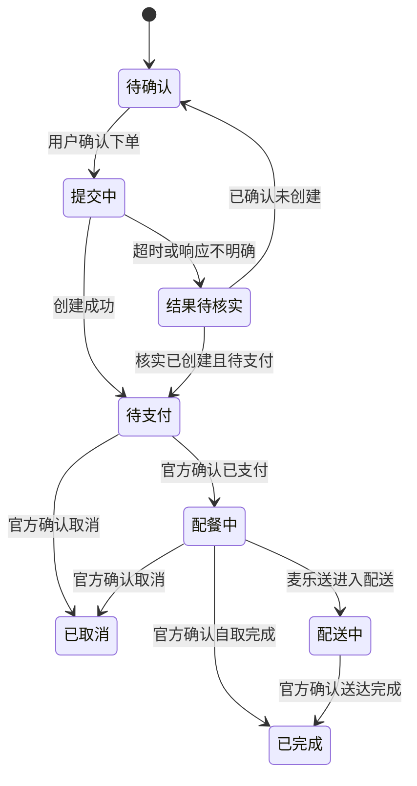

# 点餐助手需求梳理记录

更新时间：2026-10-24（北京时间）

状态：逐项讨论及终稿生成已获用户确认；正式 PRD 已生成，详见 [PRD-001](prd/PRD-001.md)。

## 已确认的产品范围

- 交付两个独立入口：点餐 Skill 与手机 H5。两端各自完成选餐、热量分析、优惠试算、确认下单、官方支付引导和订单查询。
- H5 风格参考麦当劳点餐程序。按用户最新调整，本次只交付点餐 Skill 与手机 H5，微信小程序暂不做，不纳入本次设计、适配及验收。具体技术框架由实现阶段决定。
- 用户已选择首版面向自用／演示，使用自己的麦当劳账户。
- 用户已选择首版支持到店自取与麦乐送。
- 用户已选择首版仅支持立即取餐／尽快配送，预约不纳入首版。
- 用户已选择卡路里统一显示为“约 X 千卡”，数值显示整数。
- 用户已选择点餐 Skill 同时兼容 WorkBuddy 与 Codex；两者均能独立完成点餐流程，不要求先打开 H5。
- 普通模式可选择全部可售产品；减脂模式可选汉堡相关产品及以黑咖啡为基础的咖啡。汉堡强制去酱，用户不能取消；咖啡默认不加配料，按用户最新要求允许选择添加奶油球，并计入估算热量。
- 用户明确接受热量为大概估算值：去酱后的影响需要合理估计；缺少原始营养数据的餐品也应合理估算，并展示整餐大概总值。
- 两端均提供手动选餐与智能配餐。
- 智能配餐支持自然语言提出热量上限、必选餐品及搭配偏好，例如“1000 千卡以下、尽可能吃饱”或“要炸鸡，其余帮我搭配”。条件解析、局部替换及验收规则已在 US-03 确认，具体实现算法后续落实。
- 默认自动匹配并使用当前账户在指定门店及就餐场景最省钱的可用券方案，经官方试算展示应付金额。允许用户手动换券，不提供主动“不用券”入口；只有查询确认无适用券时才按无券结果试算。
- 用券后的组合仍须符合用户条件；加餐凑优惠由用户决定。
- 主流程：选门店与模式 → 手动选餐／智能配餐 → 自动匹配优惠券 → 试算并展示热量与实付金额 → 用户确认 → 创建订单 → 官方支付与订单查询。

## US-01：模式切换与购物车（用户已确认）

用户价值：切换模式前了解购物车变化，保留可继续使用的选择，并使定制、热量和优惠价格保持一致。

### 模式与购物车规则

1. 普通切换至减脂时，先展示将移除的不符合减脂范围的商品及需要修改的定制。用户确认后切换；取消则保留原模式及购物车。范围已按用户最新要求扩展至汉堡及黑咖啡，咖啡可选择添加奶油球。
2. 套餐按实际组成检查；包含不符合减脂范围的饮料或小食时，不能整份加入减脂购物车。不自动拆为单品，改为单点需由用户选择并重新计价。
3. 减脂切换至普通时，保留已有商品与去酱要求，允许用户修改定制。之前移除的商品不自动恢复。
4. 减脂模式汉堡的去酱要求为固定项，手动修改和智能替换均不能取消。该模式咖啡默认不添加配料，但允许用户选择加或不加奶油球；调整后重新计算热量与价格。
5. 修改数量或餐品后，重新计算热量、匹配优惠券并试算。同款但定制不同的条目分开展示。
6. 原始热量缺失时，参考同类餐品、规格、食材及份量合理估算，并计入整餐估算值，不按零计入。界面展示“约 X 千卡”，不再只显示已知小计与未知项。
7. 有适用的去酱营养数据时直接采用；没有时，根据酱料类型、估计用量及能量密度估算扣减。调整结果标记为估算，不声称来自官方去酱营养数据。
8. 旧试算在相关选择变化后失效。试算失败保留购物车并提供重试，价格确认完成后才可提交。

### 去酱状态与失败分支

- 提交渠道待确认：继续查询餐品特制或备注能力，不能直接认定该商品不支持去酱。
- 待提交去酱要求：已找到可用提交方式，随订单提交。
- 已提交去酱要求：请求成功且确实携带该要求；页面不据此声称餐厅已经按要求制作。
- 确认无法提交：保留购物车，暂停减脂下单，提供更换商品或切换普通模式的入口。

### 已确认的 H5 布局草图

```text
+----------------------------------+
| 点餐模式       [普通] [减脂 ✓]    |
+----------------------------------+
| 汉堡名称                  [删除] |
| 不要酱 · 减脂模式固定要求        |
| 提交方式：待确认                 |
| 热量：约 … 千卡       [－] 1 [＋] |
| 咖啡名称                  [删除] |
| 奶油球：[不加 ✓] [添加]         |
| 热量：约 … 千卡       [－] 1 [＋] |
+----------------------------------+
| 优惠券：自动匹配                 |
| 整餐热量：约 … 千卡              |
| 应付金额：待试算                 |
+----------------------------------+
| [继续选餐]          [确认订单]   |
+----------------------------------+
```

Skill 通过对话呈现相同的信息，并在需要确认时等待用户选择。上述草图根据用户新增咖啡、可选奶油球及估算热量要求作了同步修订。

### 已确认的验收重点

- 取消模式切换时，原模式、商品、数量与定制保持不变。
- 减脂模式下，用户无法取消汉堡的去酱要求；咖啡支持选择加或不加奶油球，选择变化后更新单品及整餐估算热量与价格。
- 修改商品后，旧价格不可继续用于提交订单，需完成新的试算。
- 原始营养数据缺失时使用有依据的估算值，整餐展示大概总热量；不会将缺失值直接按零计入。
- 去酱提交失败或渠道尚未确认时，不显示“已提交去酱要求”。
- 确认无法提交去酱时，保留购物车并暂停减脂下单。

## US-02：卡路里分析（用户以“继续”确认推进）

### 用户最新明确要求

- 去酱应体现热量下降；即使缺少官方去酱数据，也需根据配方及用量合理估计其影响。
- 缺少部分原始营养数据时，仍提供整餐的大概热量，不以“已知小计＋未知项”作为主要展示结果。
- 减脂模式还允许黑咖啡，并按用户最新要求支持选择加或不加奶油球。

### 按用户修订明确的业务口径

- 单品和整餐统一显示“约 X 千卡”，按实际规格、数量及选中的套餐子项计算，避免套餐与子项重复计数。
- 优先使用适用的官方营养数据，缺少时参考食材、规格、份量和相近餐品估算。相同配置使用一致的估算依据，避免每次对话随意改变。
- 有准确去酱数据时直接采用；否则以标准餐品热量减去酱料估算热量，并在合理范围内校验，不随意扣除固定数值。
- 减脂模式下，咖啡以黑咖啡为基础，例如美式、浓缩等；默认不添加配料，奶油球作为用户明确允许的可选项。该模式的其他添加项暂不开放，拿铁等原配方含奶的咖啡不因“不额外加糖”而归为黑咖啡。普通模式允许当前门店全部可售咖啡及合法定制。
- 咖啡及所选奶油球热量计入整餐；优先使用对应数据，缺少时合理估算。奶油球选项、可选数量及价格按门店实际提供的能力细化。
- 推荐是否符合热量上限按估算总值判断，不再仅因缺少官方原始营养数据而排除；结果标为估算，不承诺实际制作热量精确低于上限。
- 热量上限的比较语义已在 US-03 确认：“不超过／以内／以下”包含上限，“低于／小于”不包含上限；使用显示取整前的估算值判断。
- 用户已选择统一显示“约 X 千卡”，数值为整数。实现口径为先计算再四舍五入展示，整餐先合计未取整的值再展示，热量上限判断仍使用取整前的估算值。

### 已确认的 H5 热量分析草图

```text
+----------------------------------+
| 本餐热量分析                     |
| 目标上限：[可选填写] 千卡        |
+----------------------------------+
| 汉堡（去酱）× 数量  约 … 千卡    |
| 咖啡（所选定制）× 数量           |
|                     约 … 千卡    |
+----------------------------------+
| 本餐估算热量：约 … 千卡          |
| 距目标剩余：约 … 千卡            |
| * 热量按配方、份量及定制估算     |
+----------------------------------+
| [返回调整]          [查看价格]   |
+----------------------------------+
```

单品展示值已包含所选去酱或奶油球等调整，整餐合计不再额外重复扣减或增加。未设目标时隐藏剩余额度；超过目标时改为显示约超出多少千卡。Skill 对话提供同样的单品、整餐和目标比较信息。

### 已确认的验收标准

- GIVEN 相同餐品、规格、数量和定制，WHEN 在 Skill 或 H5 查看热量，THEN 两端使用同一数据与估算口径，显示约多少整数千卡。
- GIVEN 商品数量或套餐实际子项改变，WHEN 重算，THEN 按实际构成与数量求和，套餐和子项不重复计入。
- GIVEN 缺少适用的原始营养数据，WHEN 计算热量，THEN 使用有依据的估算值并计入整餐，展示大概总值，不按零处理，也不将估算声称为官方营养数据。
- GIVEN 汉堡选择去酱，WHEN 计算热量，THEN 使用适用去酱数据或按酱料用量估算扣减，结果不得出现负值；要求已提交不等于已验证餐厅实际制作。
- GIVEN 咖啡选择添加奶油球，WHEN 更新，THEN 奶油球计入单品和整餐估算热量，取消添加后重新计算。
- GIVEN 用户设置热量目标，WHEN 比较目标，THEN 使用取整前的整餐估算值；未设目标时不自动添加上限。
- GIVEN 用户查看已调整过定制的单品与整餐，WHEN 展示明细和总计，THEN 去酱和奶油球仅按实际数量调整一次，不在单品和总计两处重复计入。

## US-03：智能配餐与局部替换（用户已确认）

用户价值：以自然语言提出本餐要求，在符合条件的实际可售组合中选择方案，并能保留喜欢的餐品继续调整。

### 已确认业务规则

1. 识别热量上限、预算、必选餐品、排除项与搭配偏好。热量按估算值计算；预算以门店可用优惠券参与后的官方试算应付总额核对，包括适用的配送、打包及餐具等必要费用。
2. 未提出的热量或预算上限不自动补上。条件有歧义且影响选餐时，补问必要信息。
3. 按表达区分临界值：“不超过／以内／以下”包含上限，“低于／小于”不含上限；按展示取整前的估算热量判断。
4. 先满足模式、必选项、热量和预算等约束，再按“尽量吃饱”“更便宜”等偏好排序。饱腹偏好仅以可获得的餐品组成、份量等信息作粗略参考，不显示精确饱腹评分。
5. 最多展示三个有效方案，列出具体餐品、规格、数量、估算总热量、优惠后试算价格、所用优惠和推荐理由。
6. 泛指“炸鸡”等类别时，可先展示包含具体商品和数量的候选；用户接受后才形成明确锁定项。若用户已经指定具体商品、规格或数量，则优先保留该项。
7. “保留炸鸡，其余换一套”仅替换未锁定餐品；每次变化都重新估算热量、匹配可用券并试算价格。
8. 购物车已有餐品时，默认将其计入本餐并作为已选项保留，热量和预算目标覆盖整车。若用户要求重新搭配，先展示将替换的内容，经确认后再更新购物车。
9. 普通模式可以提出热量目标；减脂模式仍执行汉堡强制去酱、黑咖啡可选奶油球等规则。需求冲突时，由用户修改需求或确认切换模式。
10. 无符合条件的组合时，解释主要阻碍并让用户选择放宽条件；不静默提高上限、修改必选项或切换模式。
11. 菜单、优惠或试算查询失败时保留已输入需求及原购物车，说明暂未完成的环节并提供重试；未试算成功的金额不标为最终应付价。
12. 生成推荐不创建订单。用户选定方案进入购物车并核对价格与定制后，明确确认才创建订单。两端沿用同一套条件与估算规则，分别使用对话和可视化卡片交互。

### 已确认的 H5 布局草图

```text
+----------------------------------+
| 智能配餐              普通模式   |
| [说说你想吃什么……             ] |
| 已识别条件：热量上限／必选餐品   |
| 搭配偏好：……          [修改条件]|
+----------------------------------+
| 推荐方案                         |
| 餐品、规格、数量                 |
| 总热量：约 … 千卡                |
| 优惠后试算价：¥ …                |
| 推荐理由：……                    |
| [锁定餐品] [换一套] [选择此方案] |
+----------------------------------+
```

Skill 先简述识别的条件，再展示方案；用户可通过“保留某餐品”“换掉某餐品”等表达完成等价操作。

### 已确认的验收标准

- 场景一：热量目标与临界值
  - GIVEN 用户设置“本餐不超过 1000 kcal”，且候选商品均有对应营养数据或有依据的估算值。
  - WHEN 系统筛选组合。
  - THEN 按整车估算热量筛选，等于 1000 的组合可纳入，大于 1000 的组合不可标为满足条件；“低于 1000”不包含等于的组合。判断使用展示取整前的估算值。
- 场景二：已有购物车
  - GIVEN 购物车已有用户选定的餐品，用户要求继续配餐并设置本餐热量或预算上限。
  - WHEN 系统生成新增配餐。
  - THEN 保留原商品及数量、规格和定制，并将其纳入整车总热量和应付金额；不能只计算新增商品。
- 场景三：锁定并局部替换
  - GIVEN 用户已锁定具体炸鸡商品及其规格、数量和定制，当前为普通模式。
  - WHEN 用户要求“保留炸鸡，其他换一套”。
  - THEN 仅调整未锁定商品，重新估算整餐热量、匹配券并试算，不能沿用上一套价格。
- 场景四：减脂模式与奶油球
  - GIVEN 当前为减脂模式，组合包含汉堡与咖啡。
  - WHEN 用户生成或调整组合，包括选择添加奶油球。
  - THEN 汉堡去酱要求不可取消；奶油球按实际选择计入热量与价格，并重新校验目标。若要求不符合模式的商品，则提示用户选择修改条件或切换模式。
- 场景五：预算与优惠
  - GIVEN 用户设定整餐预算，门店存在可用券及适用费用。
  - WHEN 系统展示有效推荐方案。
  - THEN 展示官方试算的优惠后应付总额及所用优惠；推荐结果须在预算内，不能通过省略费用或擅自加餐凑券来宣称满足预算。
- 场景六：无符合条件的组合
  - GIVEN 用户的模式、必选品、热量或预算条件无法同时满足。
  - WHEN 系统完成候选筛选。
  - THEN 说明主要冲突并请用户选择调整条件，不擅自提高上限、删掉必选品或切换模式。
- 场景七：查询或试算失败
  - GIVEN 查询菜单、优惠或试算过程中失败。
  - WHEN 系统展示处理结果。
  - THEN 保留输入条件与原购物车，标明未完成环节并提供重试；不展示未经确认的最终应付价，不创建订单。
- 场景八：应用方案与过期结果
  - GIVEN 用户查看推荐时可能修改目标或购物车，也可能重复点击选择按钮。
  - WHEN 新结果返回或用户应用方案。
  - THEN 仅应用与当前条件一致的结果，预览与实际商品相符，重复点击不重复加餐；取消或应用失败时保留原购物车。若餐品售罄、券失效或价格变化，重新计算并让用户确认，不静默换品。
- 场景九：两端一致与下单确认
  - GIVEN Skill 与 H5 使用同一门店、同一组需求和同一版本的菜单、营养估算及优惠数据。
  - WHEN 用户进行对应的推荐或调整操作。
  - THEN 两端按相同规则校验模式、估算热量及预算；生成推荐不创建订单，只有明确确认下单后才进入创建订单流程。

## US-04：自动用券与价格确认（用户以“继续”确认推进）

用户价值：在不改变本餐要求的前提下，自动使用当前订单可用的优惠券，查看真实试算金额并保留本单的选券控制权。

### 已确认的范围

- 匹配当前账户已持有、当前门店、取餐方式、时段及餐品可用的券，最终以官方试算为准。
- 不擅自添加餐品凑优惠，不突破模式、必选品、热量和预算条件。
- 餐品与定制变化后重新匹配和试算；价格变化需用户确认。
- 用户最新明确：默认使用最省钱的可用券方案，允许换券；不设计主动不用券选项，无可用券时才不用券。

### 已确认的业务规则

1. 默认启用自动选券，从经过规则校验与官方试算的可用券方案中选择应付总额最低的方案，并展示所用券及试算金额。
2. 券是否可叠加、是否互斥及适用范围均遵循官方规则与试算结果，不直接把券面金额相加。
3. 确认页提供“自动选券／手动换券”，不提供主动“不用券”入口。手动选择仅影响当前订单，选择后保持该选择，变化时重新校验，不静默切回自动。
4. 查询成功但没有可用券时，展示“暂无可用券”及正常试算的应付金额。无券不等于没有其他官方优惠。
5. 优惠查询失败时，展示“优惠暂未确认”，保留购物车并提供重试，不能把查询失败当作无券直接下单，也不提供跳过选券的常规入口。
6. 门店、方式、餐品、数量、定制或下单时段变化后重新校验。自动模式重新匹配；手动券失效时展示原因，让用户改选或恢复自动选券；只有查询确认已无适用券时才按无券结果试算。
7. 券失效或金额变化时展示新旧应付金额及原因；重新符合预算等条件后，等待用户确认再继续。旧试算不可用于创建订单。
8. 金额展示包括商品费用、优惠及适用的配送、打包、餐具等费用，并突出最终应付总额。
9. 首版范围为使用已有券；自动领取新券、付费购券或积分兑换不作为本故事的既定范围。
10. Skill 使用对话完成等价操作，例如“换一张券”“恢复自动选券”。首版不设计主动不用券的常规动作。当前仍是需求梳理，本轮不执行任何实际用券或账户变更。

### 已确认的 H5 布局草图

```text
+----------------------------------+
| 本单优惠                         |
| [自动选券 ✓] [手动换券]         |
| 当前选择：优惠券名称             |
| 适用商品：……                    |
+----------------------------------+
| 商品费用                  ¥ …    |
| 配送 / 打包等费用         ¥ …    |
| 优惠金额                 -¥ …    |
| 应付总额                  ¥ …    |
+----------------------------------+
| [返回购物车]         [确认优惠]  |
+----------------------------------+
```

查询中或失败时在优惠区域显示对应状态，未完成的新试算不能作为最终金额提交。

### 已确认的验收标准

- 场景一：默认自动选券
  - GIVEN 当前账户、门店、取餐方式、时段和餐品确定，存在多个通过官方规则校验并完成试算的用券方案。
  - WHEN 用户查看本单优惠，且尚未手动指定券。
  - THEN 自动使用应付总额最低的可用方案，金额包括适用的配送、打包等费用；展示选中券、优惠及最终应付，不仅比较券面金额。
- 场景二：手动换券与恢复自动
  - GIVEN 当前已有自动选券结果。
  - WHEN 用户手动选择另一张可用券。
  - THEN 重新试算并保留用户选择，展示最新应付及金额变化；即使其比自动方案更贵也不静默改回。若超出预算，提示用户调整条件。用户主动恢复自动后才重新按最低应付选择。
- 场景三：确实没有适用券
  - GIVEN 正确门店、方式、时段及商品条件下的查询与适用校验已成功完成，确认没有可用券。
  - WHEN 用户查看本单优惠。
  - THEN 显示“暂无可用券”，按无券方式进行正常官方试算，并保留可能存在的其他官方优惠。
- 场景四：优惠查询或校验失败
  - GIVEN 优惠查询、适用校验或相关试算超时、报错或尚未完成。
  - WHEN 系统展示处理结果。
  - THEN 显示“优惠暂未确认”及重试入口，保留购物车，不将失败等同于无券，不以未经确认的金额提交订单。
- 场景五：不提供主动不用券入口
  - GIVEN 用户正在 H5 或 Skill 的正常优惠选择流程中。
  - WHEN 系统展示可选操作。
  - THEN 只提供自动选券、换券或恢复自动等适用操作，不展示主动“不用券”选项；仅在确认没有适用券时进入无券试算。
- 场景六：餐品、场景变化及过期响应
  - GIVEN 用户修改门店、取餐方式、餐品、数量或定制，或下单时段发生变化。
  - WHEN 重新匹配优惠并试算。
  - THEN 旧结果失效，迟到的旧响应不能覆盖新购物车；手动券失效时提示改选或恢复自动，不静默更改选择。新金额、失效原因及变化需明确展示，并由用户确认后继续。
- 场景七：组合约束
  - GIVEN 可用券存在商品、叠加、门槛或模式相关限制。
  - WHEN 系统尝试自动选券或推荐配餐。
  - THEN 遵循官方校验，不重复使用不允许重复的券，不把互斥券相加，不擅自加餐、取消锁定项、突破热量预算或减脂模式规则。
- 场景八：两端一致
  - GIVEN Skill 与 H5 使用同一账户、门店、场景、购物车及同一版本的优惠与试算数据。
  - WHEN 用户执行等价的自动选券或换券操作。
  - THEN 两端采用相同的选券规则和应付金额口径，均展示优惠确认状态，并将价格变化纳入下单前确认。

## US-05：账户连接、门店与取餐方式（用户以“继续”确认推进）

用户价值：使用本人的麦当劳账户，为本餐选择实际可用的门店或配送地址，并据此获取正确菜单、价格与优惠。

### 用户已确认的范围

- 首版用于自用／演示，连接用户自己的麦当劳账户。
- 支持到店自取与麦乐送。
- 首版仅支持立即取餐／尽快配送。
- Skill 同时兼容 WorkBuddy 与 Codex，H5 提供独立可视化入口。

### 已确认的业务规则

1. 固定使用本人账户，提供未连接、已连接、连接失效及查询失败等清晰状态。凭据失效时保留购物车和需求，提示重新配置后重试。
2. H5 的麦当劳凭据在服务端配置，页面只展示连接状态；Skill 在对应客户端配置 MCP 连接。项目文档和示例使用占位符，不写入真实凭据。
3. 到店自取支持查询收藏门店及按城市、位置关键词搜索。无收藏时仍可搜索；展示真实门店名称、地址及营业状态，由用户选择门店。
4. 麦乐送先查询并选择已有配送地址，再查询该地址可配送门店，由用户选择。提供新增地址入口，填写接口需要的真实联系与地址信息，经用户保存后创建，不虚构地址或联系人。
5. 门店及方式确定后，查询该场景的可售菜单、可用券和价格；不能将到店菜单直接当作外送菜单使用。
6. 地址无配送门店、门店暂停营业、搜索无结果或查询失败时，分别说明原因，允许修改搜索条件、地址或重试，不自动改为另一门店下单。
7. 更换门店、地址或取餐方式时，对已有购物车重新检查商品、规格、定制、去酱提交能力、优惠及价格。能在新场景准确匹配的条目可保留，其他条目列出变化，不按同名商品直接替换。由用户确认变化后更新，取消则保留原场景和购物车。
8. 新场景确认完成前旧试算不可用于下单；用户快速切换时，旧查询结果不能覆盖新选择。
9. 首版按用户选择仅支持立即取餐／尽快配送。页面不提供预约选择；Skill 遇到预约需求时说明首版范围，不擅自把预约需求改成立即下单。

### 已确认的 H5 布局草图

```text
+----------------------------------+
| 麦当劳账户：已连接               |
| [到店自取 ✓] [麦乐送]           |
+----------------------------------+
| 自取：城市 [……] 关键词 [……]    |
| [收藏门店]              [搜索]  |
| 外送：配送地址 [选择／新增]      |
| * 按当前取餐方式展示对应区域     |
+----------------------------------+
| 门店名称                         |
| 地址：……   营业状态：……        |
|                       [选这家]  |
+----------------------------------+
| 当前门店：……         [开始点餐] |
+----------------------------------+
```

Skill 以对话收集城市／位置或选择配送地址，再列出实际可用门店并等待用户选择。

### 已确认的验收标准

- 场景一：账户连接及恢复
  - GIVEN 用户已有配餐需求与购物车。
  - WHEN 账户凭据失效或连接失败。
  - THEN 展示对应连接状态，保留餐品、数量、规格、定制与目标；重新连接后重查菜单、优惠和价格，不能沿用失效前金额下单。
- 场景二：到店自取选店
  - GIVEN 用户选择到店自取。
  - WHEN 查询收藏门店或按城市、位置关键词搜索。
  - THEN 展示实际返回的门店名称、地址和营业状态，由用户选择；收藏为空时可继续搜索，不能把查询失败当作无门店。
- 场景三：麦乐送选店与新增地址
  - GIVEN 用户选择麦乐送。
  - WHEN 选择已有地址或填写真实信息保存新地址。
  - THEN 按所选地址查询可配送门店，不用普通附近门店替代；新增地址失败时保留表单并说明原因，不把未保存地址当作已创建。
- 场景四：场景变化及取消
  - GIVEN 用户已有门店、方式、地址与购物车。
  - WHEN 更换这些选择导致商品、定制、优惠或价格变化。
  - THEN 展示差异并等待确认，不能静默替换或删除锁定餐品；确认后更新并重新试算，取消时保留原场景及购物车。
- 场景五：无结果、暂停营业及查询失败
  - GIVEN 当前搜索或地址没有适用门店，或门店暂停营业，或查询失败。
  - WHEN 展示结果。
  - THEN 分别提示实际原因，提供修改位置／地址或重试入口；首版即时取送场景不将暂停接单门店作为可立即下单门店，不自动改为预约或换店下单。
- 场景六：旧响应与双端一致
  - GIVEN 用户连续修改城市、地址或门店。
  - WHEN 较早查询的结果稍后返回。
  - THEN 旧结果不能覆盖最新选择，旧菜单、券和金额不能用于下单；Skill 与 H5 均执行同样规则。
- 场景七：时间范围
  - GIVEN 用户进入首版 H5 或 Skill 点餐流程。
  - WHEN 选择取送时间或提出预约需求。
  - THEN H5 仅提供立即取餐／尽快配送；Skill 明确说明首版不支持预约，并由用户决定是否改为即时取送，不自动创建即时订单。

## US-06：创建订单、官方支付与订单状态（用户以“继续”确认推进）

用户价值：在确认本餐内容与应付金额后完成真实下单，能够继续支付、核对状态并查看实际返回的取餐或配送信息。

### 已确认的业务规则

1. 创建前展示门店／配送地址、取餐方式、餐品及数量、定制、约整数千卡、所用券及含适用费用的应付总额。H5 点击“确认并创建订单”，Skill 在复述当前内容后接受明确的下单确认。
2. 同一端同一次确认在提交期间只发出一次创建请求，提交按钮显示处理中；单纯查看推荐、切换页面或说“看看这套”不会创建订单。
3. 创建成功后保留订单号、原始官方支付链接及返回的支付截止信息，提供“前往官方支付”和“查询订单”。各端应能继续处理本端待支付记录，不依赖打开另一入口。
4. 创建超时或连接断开时显示“下单结果待核实”，保留购物车和确认内容，不自动重试创建。已知订单号时直接查询；未知时查询近期订单辅助核对，存在歧义则交由用户核实，不能仅凭相同金额自动关联。暂未查到不代表已证实未创建。
5. 支付使用创建结果返回的原始官方链接，不根据支付编号猜造链接。H5 尝试打开官方收银台；Skill 提供可打开的官方支付入口。手机浏览器与 Skill 客户端的支付入口兼容性需联调验证。
6. 用户从支付页返回、点击刷新或说“支付完成／支付失败”后，查询官方订单状态再展示结果。返回页面或用户自述不直接等于支付成功。
7. 待支付时允许在原订单继续支付；原链接无法恢复或支付截止时间已到时，先核对订单状态，再提示通过官方订单渠道处理，不为获取新链接直接重建一单。
8. 展示官方返回的待支付、配餐中、配送中、已完成、已取消等状态；未知或查询失败显示“状态暂未确认”，保留订单记录并提供重查。
9. 到店订单仅在实际返回时展示取餐码、取餐柜二维码或密码；外送展示实际返回的地址、预计送达及配送信息，不补造取餐或骑手信息。
10. 用户已确认首版提供主动发起的取消入口：确认具体订单并选择取消原因后提交。展示官方结果并重新查询状态；未确认成功时不显示已取消，不承诺任何状态均可取消或自动退款。
11. Skill 与 H5 的业务确认、状态口径及错误处理一致。跨客户端重复提交仍需结合订单记录核实，不能声称官方未提供的全局幂等能力已经存在。

### 已确认的 H5 布局草图

```text
+----------------------------------+
| 确认订单                         |
| 门店／地址：……                  |
| 取餐方式：……                    |
| 餐品、数量及定制：……            |
| 整餐热量：约 … 千卡              |
| 使用优惠券：……                  |
| 应付总额：¥ …                    |
+----------------------------------+
| [返回修改]   [确认并创建订单]    |
+----------------------------------+

+----------------------------------+
| 订单详情                         |
| 订单号：……  状态：待支付        |
| 门店／地址：……                  |
| 应付总额：¥ …                    |
| 支付截止：以返回信息为准         |
| 取餐／配送信息：按实际状态展示   |
+----------------------------------+
| [前往官方支付] [刷新订单状态]    |
| [取消订单]                      |
+----------------------------------+
```

按钮随实际状态变化；“前往官方支付”只在已确认待支付且有有效入口时提供。“取消订单”不代表官方保证可取消，请求结果需要按实际情况处理。

### 已确认的状态流转草图



若查询时订单已经完成或取消，直接采用官方最新状态；图中状态不要求用户逐个经历。支付截止不直接等同于已取消，需再查询官方状态。

### 已确认的验收标准

- 场景一：确认与重复提交
  - GIVEN 用户已经查看并明确确认本餐内容、定制、优惠和最新应付金额。
  - WHEN 点击创建订单或在 Skill 确认下单，包括短时间重复操作。
  - THEN 同一端同一次确认只发起一次创建请求，处理中不能重复提交；仅查看推荐或进入确认页不会创建订单。
- 场景二：创建结果未决
  - GIVEN 创建请求超时、断线或返回不明确。
  - WHEN 用户刷新、重新进入或要求重试。
  - THEN 保留“下单结果待核实”，优先核对已有订单，不自动再次创建；近期订单暂未查到不等于已确认未创建，存在匹配歧义时不能自行关联。
- 场景三：待支付恢复
  - GIVEN 创建成功并返回订单号、原始官方支付链接及可用的支付截止信息。
  - WHEN 用户打开支付页、返回或重新进入本端订单记录。
  - THEN 已保留的信息可用于恢复同一订单并继续官方支付；不根据支付编号猜造链接，不为补支付链接重新创建订单。原入口无法恢复时提供官方订单渠道核对提示。
- 场景四：支付状态核实与超期
  - GIVEN 用户从支付页返回、表示支付成功或失败，或支付截止时间已到。
  - WHEN 刷新订单状态。
  - THEN 以官方查询结果展示待支付、配餐、配送、完成或取消；不能仅凭返回页面、自述或本地时间判定支付成功或订单取消。查询失败时保留订单并显示状态待确认。
- 场景五：确认金额与实际返回金额
  - GIVEN 用户已确认试算金额，创建返回的订单金额发生变化。
  - WHEN 展示订单及支付入口。
  - THEN 明确展示新旧金额及可获得的变化原因，由用户核对后前往官方支付，不沿用旧金额误导用户。
- 场景六：取餐及配送信息
  - GIVEN 官方订单返回取餐码、取餐柜二维码／密码或配送信息。
  - WHEN 展示订单详情。
  - THEN 只展示本订单实际返回且适用的信息；未返回的信息不虚构，未确认支付时不声称已经进入配餐。
- 场景七：取消结果与竞争状态
  - GIVEN 用户选择具体订单和取消原因并明确确认。
  - WHEN 发起取消，可能出现取消结果为 false、超时或与支付同时发生。
  - THEN 依据具体取消结果及重新查询的官方状态展示；仅请求返回成功不能忽略取消结果为 false，超时不显示已取消，不自动重复取消；取消成功不等同于退款已完成。
- 场景八：双端完整流程
  - GIVEN Skill 在 WorkBuddy 或 Codex 已正确配置，或 H5 已连接本人账户。
  - WHEN 用户从确认本餐开始完成下单、官方支付引导、状态查询或取消。
  - THEN 各入口均能独立完成对应流程，显示同一套业务状态及错误处理；本阶段联调需实际验证官方支付入口兼容性，不能仅凭模拟成功标为闭环已完成。

## US-07：手动浏览菜单与选配餐品（用户以“继续”确认推进）

用户价值：以熟悉的分类点餐方式浏览当前门店餐品，在了解价格和大概热量后选择规格、套餐组成及定制，加入购物车。

### 已确认的业务规则

1. H5 首页参考麦当劳的分类点餐结构，采用浅色背景、黄色主按钮与红色金额等强调信息。顶部显示当前门店与取餐方式，提供普通／减脂模式及手动点餐／智能配餐入口。
2. 菜单仅来自当前门店和取餐方式；左侧分类、右侧商品卡片。明确提供“汉堡”类目，展示当前门店可售的汉堡；普通模式其他分类按门店实际菜单展示，减脂模式保留“汉堡／咖啡”类目。类目内暂无可售商品时展示空态。提供商品名称搜索，分类和搜索都执行当前模式的商品与组成限制，不能用搜索绕过减脂规则。
3. 商品卡片展示图片、名称、可获得的规格提示、约整数千卡及接口返回的当前商品价。商品展示价与整单用券后应付价分开；后者以购物车试算为准。
4. 简单商品可直接添加；需要选择规格、套餐组成或定制时，打开详情，按官方给出的默认项、必选数量和可替换范围选择。未满足必选条件时说明原因，不能加入无效配置。
5. 减脂模式下，汉堡的去酱要求固定，并显示其提交渠道的确认状态；咖啡提供门店实际支持的奶油球选项，默认不加，选择后更新热量及价格。普通模式按餐品的合法选项定制。接口不提供某选项时，不虚构已完成定制。
6. 详情中更换套餐子项、规格、数量或奶油球后，更新本商品大概热量与价格信息；加入后执行购物车、优惠和整餐热量重算。
7. 底部固定购物车摘要，展示件数、整餐约整数千卡及当前试算应付总额，提供进入购物车／结算入口。试算中或失败时显示相应状态，不把旧金额当作已确认的新金额。
8. 点击整餐热量可查看 US-02 的热量分析信息，再返回继续选餐。未设置热量目标时，不自动添加上限。
9. 无搜索结果、菜单查询失败、商品售罄或规格发生变化分别提示；保留搜索条件及已有购物车，刷新或重新选择，不静默替换用户餐品。
10. Skill 提供等价的分类浏览、名称搜索、商品规格选择和加购操作，允许自然语言选择；同名或多规格存在歧义时列出选择项，不要求通过 H5 才能完成手动选餐。

### 已确认的 H5 首页草图

```text
+----------------------------------+
| 当前门店／取餐方式       [切换]  |
| [普通 ✓] [减脂]                 |
| [手动点餐 ✓] [智能配餐]         |
| [搜索餐品……                   ] |
+--------+-------------------------+
| 汉堡   | [图片] 餐品名称         |
| 小食   | 约 … 千卡   ¥ …         |
| 饮品   |             [＋／选规格]|
| 咖啡   | 其他餐品卡片            |
| ……   |                         |
+--------+-------------------------+
| 购物车 … 件｜本餐约 … 千卡       |
| 应付 ¥ …              [去结算]  |
+----------------------------------+
```

### 已确认的 H5 商品详情草图

```text
+----------------------------------+
| 餐品图片、名称                   |
| 展示价 ¥ … ｜约 … 千卡          |
| 规格／套餐子项：[按可选项展示]   |
| 定制：[按模式与商品能力展示]     |
| 数量：              [－] 1 [＋]  |
+----------------------------------+
| [返回菜单]          [加入购物车] |
+----------------------------------+
```

减脂汉堡显示固定去酱要求；咖啡显示奶油球选择；只有实际支持的配置项才可操作。

### 已确认的验收标准

- 场景一：菜单上下文与模式筛选
  - GIVEN 用户已选定门店、取餐方式及普通或减脂模式。
  - WHEN 浏览分类、搜索商品或直接打开商品详情。
  - THEN 明确提供汉堡类目，减脂模式选餐类目为汉堡与咖啡，仅允许选择该场景实际可售且符合模式的商品；名称搜索、分类及详情入口均不能绕过组成与模式校验，切换门店后的旧菜单不能覆盖新场景。
- 场景二：商品配置有效性
  - GIVEN 商品包含规格、套餐轮次、必选数量或可替换选项。
  - WHEN 用户打开详情并选择配置。
  - THEN 仅提供实际支持的选项，按有效默认项初始化，未完成必选项时不能加入无效配置；实际加入的规格、数量和定制与预览一致。同一次加购提交重复触发不重复插入，用户主动加减数量则按其选择更新。
- 场景三：去酱及奶油球
  - GIVEN 当前为减脂模式。
  - WHEN 选择汉堡或咖啡。
  - THEN 汉堡去酱为固定要求且显示提交渠道状态；咖啡允许选择实际支持的奶油球选项，选择变化后更新热量及价格。不存在的选项不能显示为已经完成。
- 场景四：热量与价格联动
  - GIVEN 用户更改规格、套餐子项、数量或定制并加入购物车。
  - WHEN 更新商品与整餐信息。
  - THEN 展示约整数千卡，按实际组成求和；卡片展示当前商品价，购物车展示最新整单优惠后试算金额，试算处理中或失败时不能将旧价标为最新最终应付。
- 场景五：无结果与加入失败
  - GIVEN 菜单加载失败、搜索无匹配、商品售罄、配置失效或加购失败。
  - WHEN 展示处理结果。
  - THEN 区分原因，保留搜索条件、可保留的配置及原购物车，提供刷新或修改入口；不虚构加购成功，不静默替换商品。
- 场景六：H5 手机布局
  - GIVEN 用户在手机宽度下浏览首页、详情和购物车。
  - WHEN 滚动列表、展开规格、打开购物车或返回菜单。
  - THEN 门店与模式入口清晰，分类、商品与价格可读可操作；底部固定购物车、系统安全区及键盘不遮挡必要内容和确认操作，返回后保留相应选餐状态。
- 场景七：Skill 等价操作
  - GIVEN 用户在 WorkBuddy 或 Codex 正确连接点餐 Skill。
  - WHEN 使用自然语言浏览分类、搜索、选规格或加入餐品。
  - THEN 完成与 H5 等价的模式校验、配置和加购；存在同名或规格歧义时列出选择，不要求用户打开 H5 才能完成。

## US-08：Skill 与 H5 独立交付和使用（用户以“继续”确认推进）

用户价值：拿到两个清晰独立的交付包，按说明配置后，可以在 WorkBuddy、Codex 或手机 H5 中独立使用完整点餐功能。

### 已确认的交付规则

1. 交付两项成果：可安装的点餐 Skill 包和可启动的 H5 工程／自用演示入口，分别提供安装／启动、配置、使用示例与常见问题说明。是否分仓及具体技术框架由实现阶段决定。
2. Skill 包包含有效 SKILL.md 入口及所需支持文件，提供 WorkBuddy 与 Codex 各自的配置说明。两种客户端均可独立完成选门店、手动／智能选餐、热量估算、自动用券、下单、官方支付引导、查单与取消。
3. H5 提供手机可操作的界面、源码、启动说明、配置样例及自用／受限演示访问说明，独立提供同样完整功能，不要求先在 Skill 发起。
4. 允许两项交付共用后端、餐品／热量基准及业务规则，保持模式、估算、用券和订单处理口径一致；共用服务的配置依赖需在说明中写清。无需先打开另一入口才能使用。
5. 本人账户凭据以及必要模型／服务配置采用安全的本地或服务端配置方式，样例使用占位符，不把真实凭据打包进公开源码、前端资源或说明。缺少配置或凭据失效时提供可理解的修复提示。
6. 分别验证 WorkBuddy、Codex 及实际演示所用手机浏览器的完整流程；联调记录区分模拟与真实调用。创建订单、付款或取消等真实操作仍由用户在相应步骤明确确认。
7. 官方支付入口在每个目标环境实际验证；支付链接未通过兼容性验证时，不能将该环境的真实点餐闭环标记为已通过。当前仍保留到店备注、具体去酱及奶油球能力等联调项。
8. 按用户最新范围，技术实现围绕手机 H5 与 Skill 的实际需要选择，不将微信小程序迁移、平台适配或发布作为本次工作或验收前提。

### 已确认的验收标准

- 场景一：WorkBuddy 独立使用
  - GIVEN 用户取得 Skill 包并按说明配置本人账户与必要连接。
  - WHEN 在 WorkBuddy 从选店开始完成一轮选餐、热量分析、用券、确认下单及后续查询。
  - THEN 不需进入 H5 完成选餐或下单，官方支付引导及订单恢复、查询和取消行为符合已确认故事。
- 场景二：Codex 独立使用
  - GIVEN 同一 Skill 的 Codex 配置完成。
  - WHEN 执行与 WorkBuddy 对应的手动和智能选餐流程。
  - THEN 功能与业务规则完整一致，不能只有一份说明而无法实际调用所需能力。
- 场景三：H5 独立使用
  - GIVEN 按启动说明运行工程，配置本人账户和必要服务，并在演示手机浏览器访问。
  - WHEN 用户完成手动／智能选餐、热量分析、优惠试算与订单操作。
  - THEN 不需安装或打开 Skill，手机界面可完整操作，真实支付入口完成目标环境验证。
- 场景四：缺配置或连接失败
  - GIVEN 某入口缺少必要配置、连接不可用或本人凭据失效。
  - WHEN 用户使用该入口。
  - THEN 给出相应配置或重试提示，保留可恢复的需求与选择，不用虚构菜单、价格、订单或支付成功来代替真实调用。
- 场景五：两项交付的业务一致性
  - GIVEN 使用同一门店、场景、选择与同一版本业务数据。
  - WHEN 在各入口进行等价操作。
  - THEN 按同样规则处理模式、奶油球、热量、优惠及确认，界面可以不同；两项交付可共用服务，其依赖与配置需明确说明，实际支付入口在对应目标环境验收。

## 接口事实与待验证项

- 已读取 MCP 工具定义，包含订单备注 remark 和餐品特制 modification。
- 官方说明明确公布了麦乐送订单备注；备注字段最多 50 字。
- 到店订单是否接受备注并传递至门店尚未实测，不能断言不支持。
- 餐品是否提供去酱特制需根据具体商品查询，缺少该选项不代表所有提交渠道都不可用。
- 支付链接在实际演示所用手机浏览器与 Skill 客户端中的打开流程仍需实测。
- 首版客户端范围已确认：WorkBuddy 与 Codex；首版使用本人账户。具体配置与手机 H5／Skill 的完整流程仍需实现和验证。

## 终稿生成状态

- US-01 至 US-08 的业务、页面与验收已按用户确认或“继续”推进完成。
- 用户已明确指令“生成prd”，正式 PRD 已生成。
- 2026-10-24 追加修订（PRD-001 V1.1）：按评审结论补齐实现口径——金额单位（试算明确为分，订单侧未标注单位的字段待实测回填）、官方订单状态映射（含 8 已评价、10 餐厅确认配餐中）、本地营养基准表与估算参数、减脂范围判定（门店分类归一→套餐组成校验→商品清单兜底，汉堡与咖啡为独立类目）、自动选券的匹配顺序与试算上限（≤8 次）、账户连接状态的探测式判定、非功能要求（性能／试算有效期／持久化／并发／隐私／留证）；并明确餐具默认“需要”、麦乐送备注最多 50 字、随单购不纳入首版。业务结论未变更。
- 2026-10-24 追加修订（PRD-001 V1.2）：用只读凭据实测门店 1450713 的分类（15 个分类 / 144 条 / 去重 129 个商品），据此校准减脂范围判定——汉堡无单一类目而分在“鸡肉汉堡/卷”“巨无霸/牛鱼肉堡”“安格斯MAX/厚牛堡”，咖啡类目名为“麦咖啡™”，8 个分类名含换行符须归一后再精确匹配；实测“麦咖啡™”12 项中仅美式、鲜萃咖啡、浓缩咖啡属黑咖啡基础。配置落到 `data/menu-taxonomy.yaml`，抓取脚本 `scripts/fetch-mcd-categories.py`，快照 `data/menu-categories.snapshot.json`。业务结论未变更。
- 2026-10-24 追加修订（PRD-001 V1.3）：实测确认去酱可通过特制项提交——单品汉堡 `modification` 含可取消的酱料项（麦辣鸡腿汉堡「麦香鸡酱」100136、板烧「烤味酱」），按 `unselectedKey` 传入被试算接受且金额不变（¥22.50 前后一致），去酱不再依赖到店备注；同时实测到店 `takeWayCode` 仅 `eat-in`（堂食）与 `locker-out`（外带），确认页需新增“堂食／外带”选择（默认外带）。成套餐（三／四件套）`rounds` 非空且含小食与饮料，减脂模式整份不放行。创建订单是否携带去酱特制仍待验证。
- 2026-10-24 追加修订（PRD-001 V1.4）：郑州复核（门店 3560134，14 个分类）。分类名集合与上海一致，仅少“蘸酱炸鸡”，归一表可跨城复用；但外带 `takeWayCode` 因门店而异（上海 `locker-out`／郑州 `take-in-store`），改为“取当次试算返回的 code、禁止写死”；同一商品跨城价格不同（2250／2350 分）；麦咖啡™ 商品随城市变化（郑州多 3 项冰品奶饮、无抹茶阿芙佳朵），因此商品清单保持“未命中即排除”。
- 2026-10-24 追加修订（PRD-001 V1.5）：实测官方营养清单（`list-nutrition-foods`，160 条、无商品编码、通用品类口径），与两家门店 141 个商品对齐——同名精确命中 22 项（覆盖麦辣鸡腿汉堡 485、板烧 391、麦香鸡 369、巨无霸 513 等核心单品），套餐 50 项禁止套用单品热量须按组成合计，归一疑似命中 12 项因规格易错仅作候选（薯条被匹到迷你薯条 106 kcal 等），57 项无对应需补录或估算。素材落盘 `data/nutrition-official.csv`、`data/nutrition-mapping.csv`，脚本 `scripts/build-nutrition-mapping.py`。
- 正式文档：[PRD-001](prd/PRD-001.md)；索引：[PRD 总集](PRD_REGISTRY.md)。需求实现与真实联调尚需按正式文档验收。
